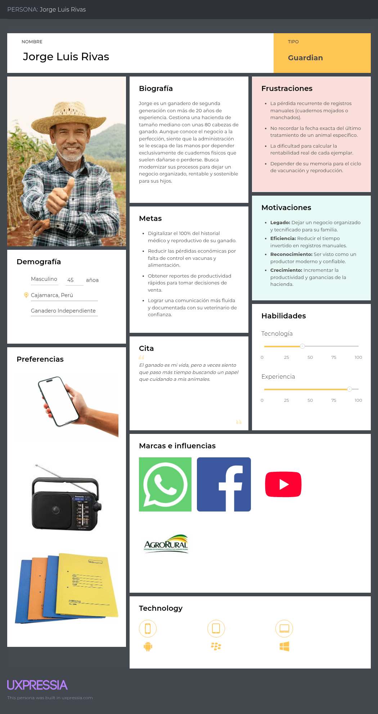
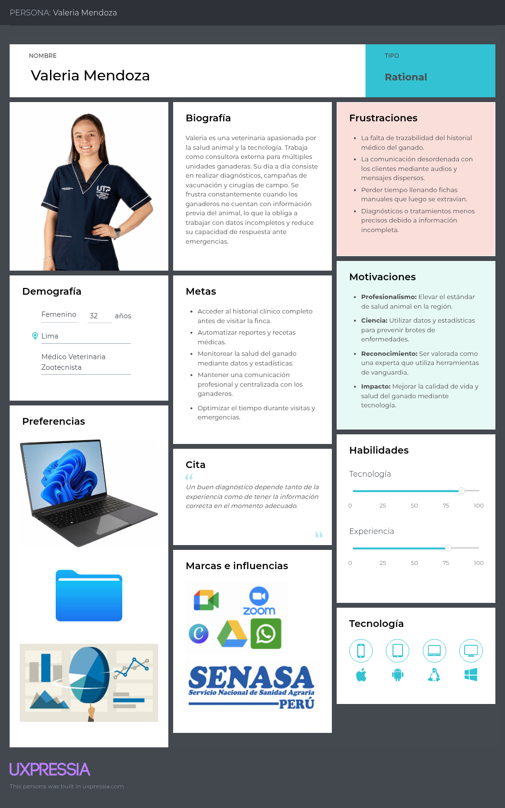
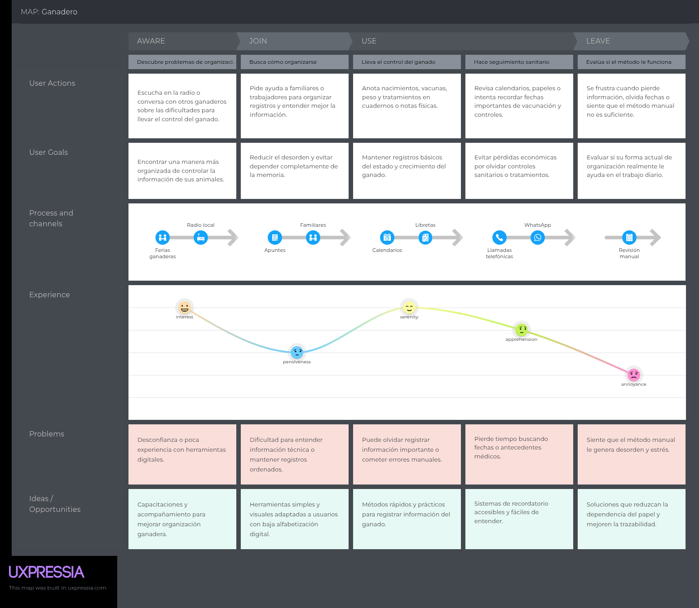
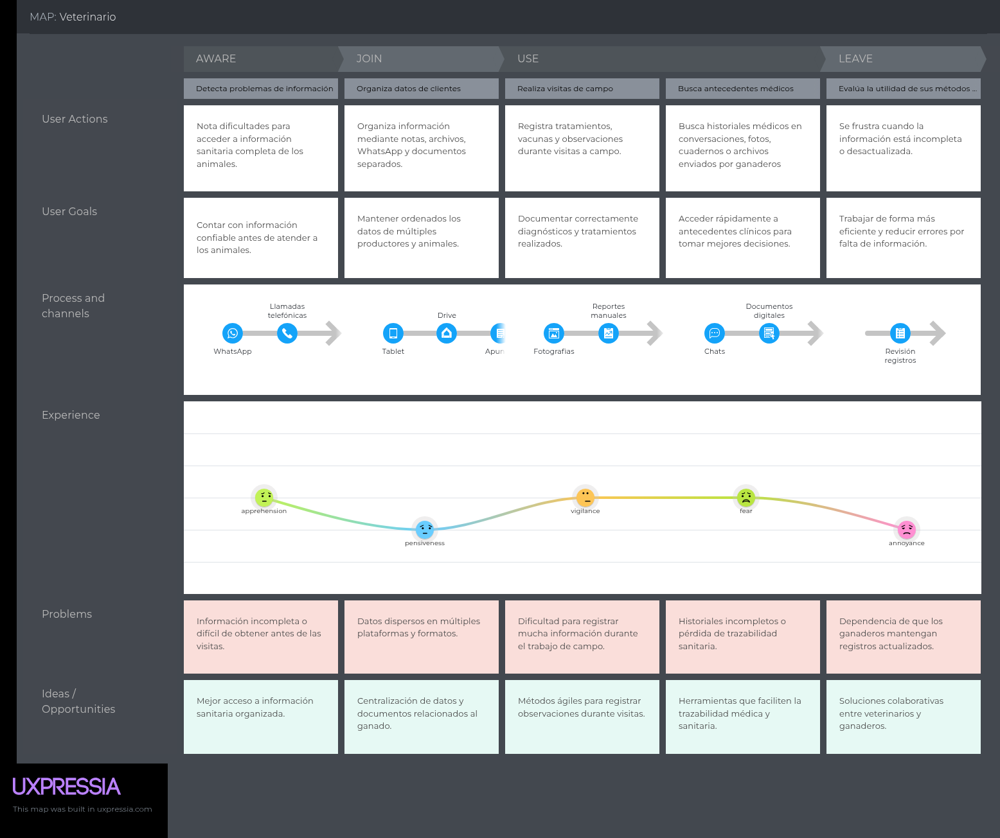
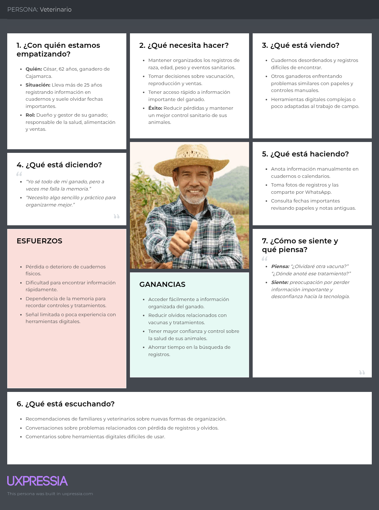
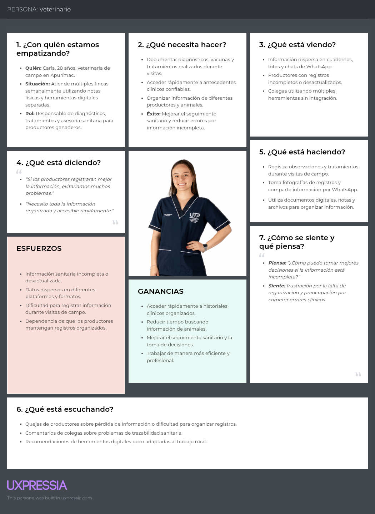
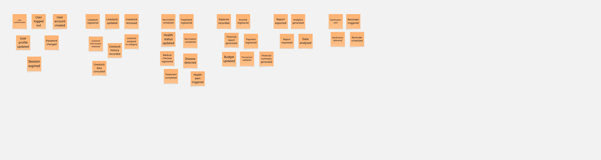
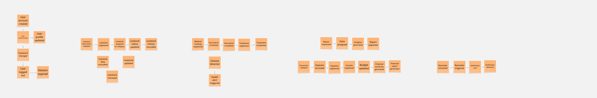
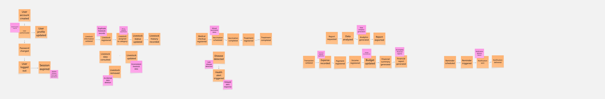

# 2.3. Needfinding

<!-- Documentation marker: Needfinding section. -->

En esta sección se presentarán los artefactos resultantes del proceso de análisis de la información recolectada de los segmentos objetivos. Aquí se incluyen secciones para User Personas, User Task Matrix, User Journey Maps, Empathy Mapping y As-is Scenario Mapping.

## 2.3.1. User Personas

A continuación, se presentan los User Personas diseñados para representar a los segmentos objetivo identificados durante la fase de investigación. Estos arquetipos detallan variables demográficas, rasgos psicográficos, motivaciones y comportamientos, así como los pains (frustraciones) y gains (objetivos) que enfrentan en su gestión diaria. Asimismo, se analiza su nivel digital y su interacción con soluciones tecnológicas del sector agropecuario. Toda la información ha sido sintetizada a partir de los insights recolectados en las entrevistas y estructurada mediante la plataforma UXPressia para garantizar una representación fiel de las necesidades del usuario.

### User Persona: Ganaderos

  

### User Persona: Veterinarios

  

## 2.3.2. User Task Matrix

A través de la User Task Matrix, es posible identificar y organizar las principales actividades que los usuarios realizan actualmente dentro de su contexto de trabajo. Al categorizar estas tareas según su frecuencia e importancia, se logra comprender cuáles representan mayores dificultades y necesidades para cada perfil de usuario, permitiendo detectar oportunidades de mejora en la gestión ganadera y veterinaria.

| **User Task**                                                                          | **Jorge Luis Rivas (Frecuencia)** | **Jorge Luis Rivas (Importancia)** | **Valeria Mendoza (Frecuencia)** | **Valeria Mendoza (Importancia)** |
| -------------------------------------------------------------------------------------- | ---------------------------- | ----------------------------- | -------------------------------- | --------------------------------- |
| Anotar el nacimiento o compra de un nuevo animal en cuadernos físicos                  | Sometimes                    | High                          | Rarely                           | Medium                            |
| Registrar manualmente vacunas y tratamientos del ganado                                | Often                        | High                          | Always                           | High                              |
| Revisar fechas de vacunación en notas, calendarios o cuadernos                         | Often                        | High                          | Often                            | High                              |
| Recordar manualmente vacunas o controles pendientes                                    | Sometimes                    | High                          | Sometimes                        | High                              |
| Anotar peso y crecimiento del ganado durante controles                                 | Often                        | Medium                        | Often                            | Medium                            |
| Revisar manualmente información sobre productividad y rendimiento                      | Sometimes                    | Medium                        | Often                            | Medium                            |
| Compartir documentos físicos o fotografías de registros con asociaciones o compradores | Rarely                       | Medium                        | Rarely                           | Low                               |
| Buscar información o capacitaciones ganaderas en internet y redes sociales             | Sometimes                    | Low                           | Sometimes                        | Medium                            |
| Llevar el control reproductivo mediante anotaciones manuales                           | Rarely                       | Medium                        | Rarely                           | Medium                            |
| Buscar antecedentes médicos y sanitarios en cuadernos o archivos físicos               | Sometimes                    | High                          | Sometimes                        | High                              |

La User Task Matrix evidencia que tanto Jorge Luis como Valeria realizan constantemente actividades relacionadas con el control sanitario y el seguimiento del ganado. Mientras Jorge Luis depende principalmente de registros físicos y de su memoria para organizar la información de sus animales, Valeria necesita acceder rápidamente a datos precisos durante sus visitas de campo y procedimientos veterinarios. Asimismo, ambos perfiles presentan dificultades relacionadas con la organización, trazabilidad y acceso oportuno a la información, especialmente en procesos de vacunación, historial clínico y monitoreo del ganado. Estas tareas permiten comprender mejor el contexto actual de los usuarios e identificar necesidades reales dentro del entorno ganadero y veterinario.

## 2.3.3. User Journey Mapping

En este apartado se describe de manera detallada el recorrido y la experiencia actual de los usuarios dentro de su contexto de trabajo cotidiano, enfocándose específicamente en los dos perfiles clave identificados: productores ganaderos y médicos veterinarios. A través de los User Journey Maps As-Is, se analizan las actividades, emociones, problemas y necesidades que experimentan los usuarios durante la gestión y seguimiento del ganado, sin considerar aún la existencia de una solución tecnológica implementada.

El mapeo de este recorrido inicia desde las primeras dificultades relacionadas con la organización y acceso a la información, avanzando a través de las tareas diarias de registro, seguimiento sanitario y búsqueda de antecedentes médicos. Asimismo, se identifican los principales puntos de contacto, canales utilizados y frustraciones presentes en el proceso actual, permitiendo comprender de forma integral cómo los usuarios realizan actualmente sus actividades y cuáles son las oportunidades de mejora dentro del entorno ganadero y veterinario.

User Ganadero:

User Veterinario:

## 2.3.4. Empathy Mapping

En esta sección se presenta el proceso de elaboración de los Empathy Maps correspondientes a los User Personas identificados para el proyecto: el productor ganadero y la médica veterinaria. Para el desarrollo de estos mapas de empatía, el equipo analizó la información obtenida durante la etapa de investigación y needfinding, considerando las necesidades, comportamientos, preocupaciones y motivaciones de cada perfil dentro de su contexto laboral cotidiano.

El proceso de elaboración inició colocando al User Persona en el centro del análisis, permitiendo identificar de manera estructurada qué piensa, siente, observa, escucha, dice y hace cada usuario en relación con la gestión sanitaria y administrativa del ganado. Asimismo, se identificaron los principales esfuerzos (Pains) y ganancias (Gains) presentes en sus actividades diarias, con el objetivo de comprender mejor sus frustraciones, expectativas y oportunidades de mejora dentro del entorno ganadero y veterinario.

Los Empathy Maps permitieron visualizar de forma más profunda la experiencia actual de los usuarios, evidenciando problemáticas relacionadas con la organización de información, trazabilidad sanitaria, dependencia de registros físicos y dificultades en la comunicación y acceso a datos confiables.

User Ganadero:

User Veterinario:

## 2.3.5. Big Picture EventStorming

El Big Picture EventStorming se desarrolló de manera colaborativa en Miro para explorar el dominio, ordenar los eventos e identificar puntos críticos en los procesos (Bourgau, 2022; Chandrasekaran, 2023; DDD by Examples, s. f.-a). El artefacto permitió construir una narrativa compartida del sector ganadero y establecer una base para el diseño posterior de la arquitectura de AniTec.

**Paso 1:** Unstructured Exploration (Exploración no estructurada) consiste en una lluvia de ideas colaborativa donde los participantes identifican y registran domain events, que son sucesos relevantes ocurridos dentro del negocio. Estos eventos deben redactarse obligatoriamente en tiempo pasado (por ejemplo, "Livestock registered") y se colocan en notas adhesivas de color naranja sobre la superficie de modelado. En esta etapa inicial, se prioriza el descubrimiento de conceptos y procesos importantes del dominio sobre el orden o la jerarquía, permitiendo identificar eventos relacionados con la autenticación de usuarios, gestión de ganado, procesos sanitarios, operaciones financieras, generación de reportes y envío de notificaciones.

**Paso 2:** Timelines, los participantes revisan los eventos de dominio generados y los organizan cronológicamente para reflejar la secuencia real de los procesos empresariales. La construcción inicia organizando el flujo principal del negocio y posteriormente incorporando relaciones, ramificaciones y dependencias entre eventos. Este paso permitió construir una narrativa visual coherente del comportamiento del sistema AniTec, facilitando la identificación de secuencias operativas, conexiones entre procesos y posibles inconsistencias dentro del dominio.

**Paso 3:** Pain Points, los participantes utilizan la línea de tiempo recién organizada para identificar los puntos críticos, riesgos o ineficiencias presentes dentro de los procesos modelados. Estos problemas se representan mediante notas adhesivas rosadas colocadas cerca de los eventos relacionados, permitiendo visualizar dificultades operativas y oportunidades de mejora dentro del sistema. Entre los principales pain points identificados destacan posibles fallos de autenticación, registros duplicados de ganado, detección tardía de enfermedades, inconsistencias presupuestarias y fallos en la entrega de notificaciones. La identificación explícita de estas debilidades permitió comprender mejor los desafíos del dominio y considerar posibles automatizaciones o mejoras futuras en el diseño del sistema.

Enlace para acceder al tablero de Miro: https://tinyurl.com/EventSorming

## 2.3.6. Ubiquitous Language

Siguiendo el concepto de **Ubiquitous Language** propuesto por Evans (2003), se presenta el siguiente glosario. Este conjunto de términos constituye el lenguaje común del proyecto y reduce ambigüedades entre el equipo de ingeniería y los expertos del dominio ganadero.

| Term (English)              | Término (Español)        | Definition (Definición)                                                                                                                                  |
| :-------------------------- | :----------------------- | :------------------------------------------------------------------------------------------------------------------------------------------------------- |
| **Livestock Owner**         | Ganadero                 | Usuario responsable de la administración operativa y financiera de la hacienda, encargado de registrar eventos diarios y tomar decisiones de producción. |
| **Veterinarian**            | Veterinario              | Profesional especializado encargado de la salud animal, responsable de emitir diagnósticos, prescribir tratamientos y validar historiales clínicos.      |
| **Herd**                    | Hato                     | Conjunto de animales agrupados dentro de una unidad productiva o finca para su control sanitario, productivo y administrativo.                          |
| **Farm**                    | Finca                    | Unidad productiva donde el ganadero organiza animales, actividades, registros sanitarios y movimientos financieros.                                     |
| **Animal**                  | Animal                   | Ejemplar individual registrado por el ganadero para mantener su trazabilidad sanitaria, productiva y económica.                                         |
| **Health Event**            | Evento sanitario         | Registro de una vacuna, enfermedad, diagnóstico, tratamiento, incidencia o seguimiento relacionado con la salud de un animal.                           |
| **Veterinary Client**       | Cliente veterinario      | Ganadero asignado a un veterinario para que este pueda revisar sus animales, consultar historiales y registrar atenciones sanitarias.                   |
| **Veterinary History**      | Historial veterinario    | Expediente clínico consolidado que permite al especialista revisar antecedentes médicos antes de realizar una intervención.                              |
| **Treatment Protocol**      | Protocolo de tratamiento | Conjunto de instrucciones médicas y fármacos asignados a un animal para tratar una afección diagnosticada por el veterinario.                            |
| **Traceability**            | Trazabilidad             | Capacidad de reconstruir el historial completo de un animal, incluyendo origen, salud, peso, actividades y cambios relevantes.                          |
| **IoT Device**              | Dispositivo IoT          | Equipo asociado a una finca o animal para apoyar el monitoreo de datos como peso, temperatura, humedad, ubicación o actividad.                         |
| **Metric**                  | Métrica                  | Lectura generada por un dispositivo o registro del sistema que permite analizar el estado de un animal, finca o proceso ganadero.                       |
| **Farm Activity**           | Actividad ganadera       | Tarea productiva, sanitaria, financiera o veterinaria programada para organizar el trabajo dentro de la operación ganadera.                             |
| **Financial Movement**      | Movimiento financiero    | Ingreso o egreso registrado por el ganadero para controlar la rentabilidad de su operación.                                                             |
| **Subscription Plan**       | Plan de suscripción      | Opción de uso de la plataforma que define condiciones, beneficios y precio para el usuario.                                                              |
| **Payment**                 | Pago                     | Registro económico asociado a la activación o renovación de un plan de suscripción dentro de AniTec.                                                    |
| **Farm Management**         | Gestión de hacienda      | Administración de los recursos, personal, animales, actividades y datos que ocurren dentro de la unidad productiva ganadera.                            |
| **Mobile Application**      | Aplicación móvil         | Software instalado en un teléfono inteligente o una tableta que permite al ganadero o veterinario gestionar información del ganado desde el campo.                     |
| **Native App**              | Aplicación nativa        | Aplicación desarrollada específicamente para un sistema operativo móvil, como Android con Kotlin, aprovechando capacidades del dispositivo.             |
| **Cross-Platform App**      | Aplicación multiplataforma | Aplicación móvil que se ejecuta en más de un sistema operativo a partir de una base de código compartida, manteniendo una experiencia coherente.     |
| **Push Notification**       | Notificación push        | Mensaje enviado al dispositivo del usuario para alertar sobre vacunaciones, tratamientos, recordatorios o eventos sanitarios pendientes.                |
| **Offline Mode**            | Modo sin conexión        | Capacidad de la aplicación móvil para registrar o consultar información esencial aunque no exista conexión a internet estable.                          |
| **Local Persistence**       | Persistencia local       | Almacenamiento de datos en el dispositivo móvil para conservar borradores, historiales básicos o registros pendientes de sincronización.                |
| **Synchronization**         | Sincronización           | Proceso mediante el cual los datos guardados en el dispositivo se actualizan con el servidor cuando se recupera la conectividad.                        |
| **Camera Capture**          | Captura con cámara       | Uso de la cámara del dispositivo móvil para identificar animales, registrar evidencias o apoyar la búsqueda visual dentro de la aplicación.             |
| **Device Capability**       | Capacidad del dispositivo | Función del hardware o sistema móvil utilizada por la aplicación, como cámara, almacenamiento local, notificaciones o sensores.                               |
| **Mobile Session**          | Sesión móvil             | Estado de autenticación del usuario dentro de la aplicación móvil que permite acceder a rutas protegidas y consumir la API de AniTec.                   |
| **Mobile Dashboard**        | Panel móvil              | Vista resumida en la aplicación móvil que muestra indicadores, alertas y accesos rápidos para facilitar decisiones en campo.                            |
| **Responsive Navigation**   | Navegación móvil         | Estructura de pantallas y menús adaptada a pantallas pequeñas para que el usuario complete tareas con pocos pasos desde el teléfono.                    |
| **API Consumption**         | Consumo de API           | Comunicación de la aplicación móvil con el backend mediante servicios REST para enviar o recibir datos del dominio ganadero.                            |
| **Draft Record**            | Borrador                 | Registro temporal guardado en el dispositivo cuando el usuario aún no puede completar o sincronizar una operación por falta de red o tiempo.            |
| **Accessibility**           | Accesibilidad            | Conjunto de prácticas de diseño móvil que facilitan el uso de la aplicación a personas con distintos niveles de experiencia digital o limitaciones.     |
| **Internationalization**    | Internacionalización     | Capacidad de la aplicación móvil para adaptar idioma, formatos y textos a diferentes contextos regionales sin cambiar la lógica del producto.           |
