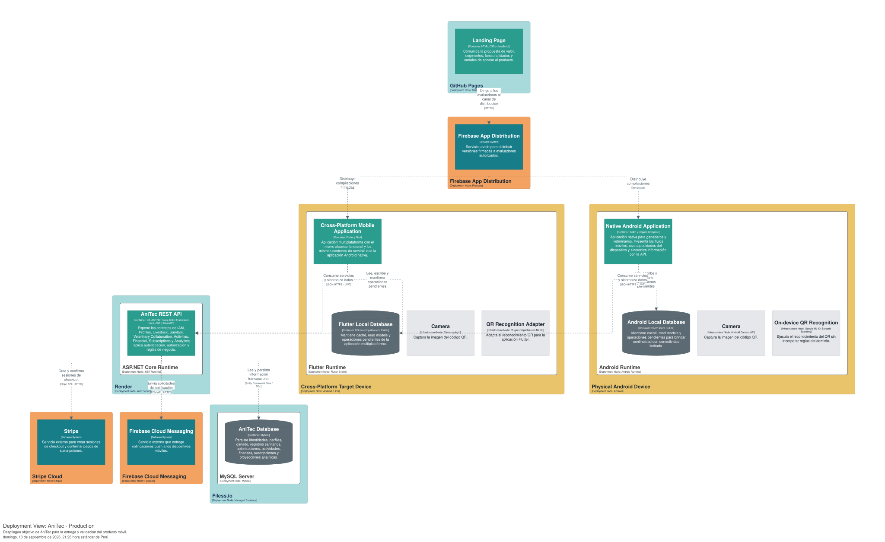
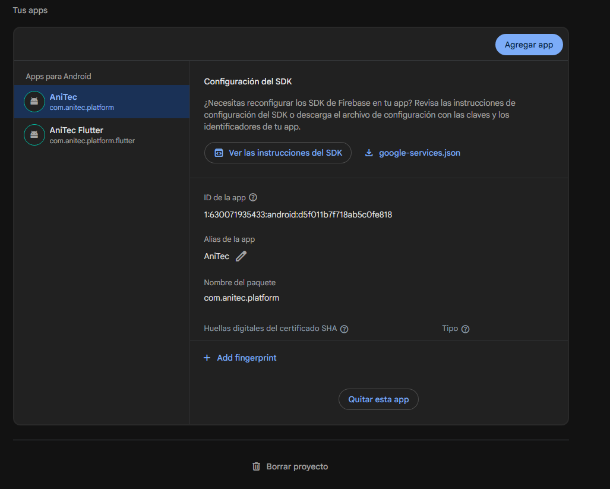
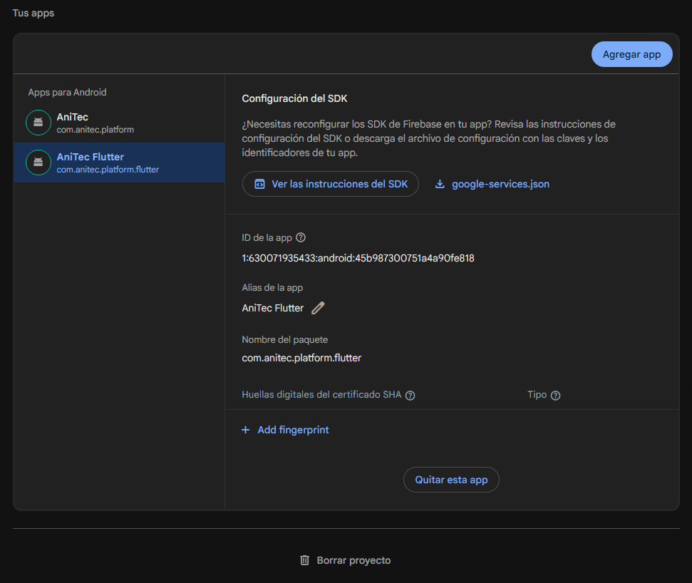
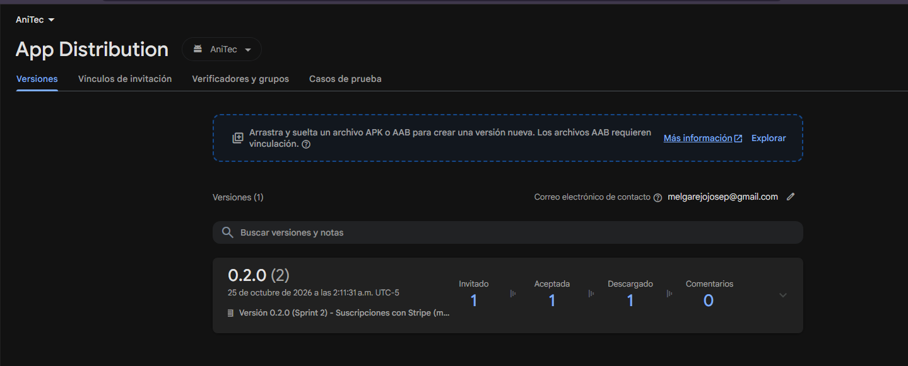
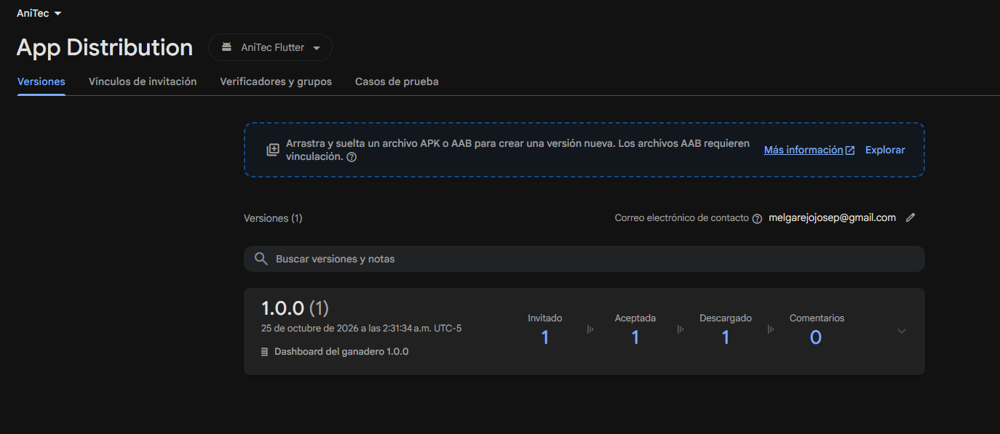
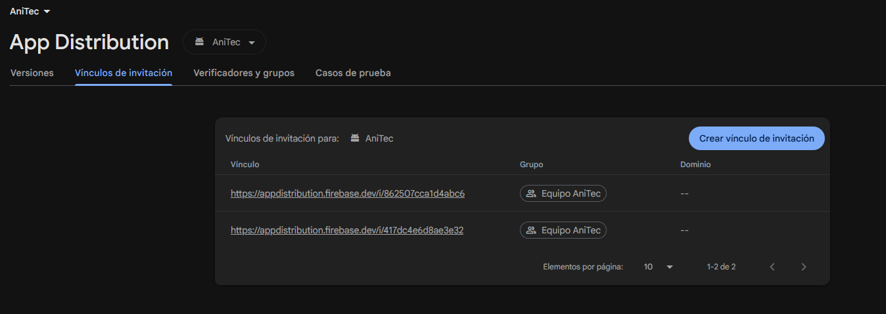
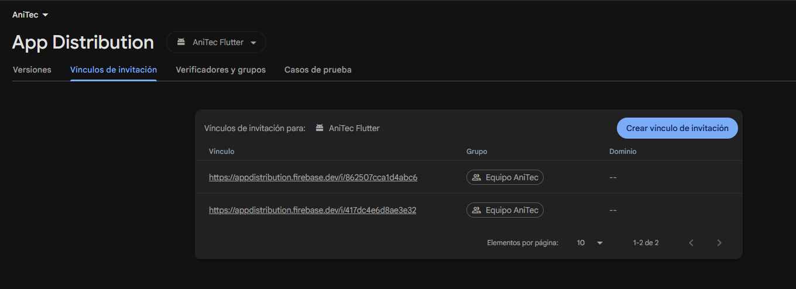

# 4.1. Software Configuration Management

La gestión de configuración de AniTec define las herramientas, repositorios, convenciones y procesos de publicación que permiten trabajar sobre la Landing Page, la API REST y las aplicaciones móviles de manera consistente y trazable.

## 4.1.1. Software Development Environment Configuration

Las herramientas se agrupan según la actividad que soportan e incluyen su propósito y su ruta de referencia (servicios en línea) o de descarga (programas instalados). Las tecnologías del proyecto son Figma, Lucidchart, Structurizr, PlantUML, HTML5/CSS3/JavaScript, ASP.NET Core con OpenAPI vía Swagger, Kotlin en Android, Flutter con Dart, Trello y Git con GitHub. Todo integrante debe utilizar versiones compatibles con los repositorios y registrar cualquier cambio de versión que afecte la compilación.

**Project Management**

| Herramienta | Propósito | Referencia |
|---|---|---|
| Trello | Organizar el Sprint Backlog y los estados de las tareas (Todo, In-Process, To-Review, Done). | <https://trello.com> |
| GitHub Issues / Projects | Dar trazabilidad a incidencias, cambios y trabajo de cada repositorio. | <https://github.com/features/issues> |

**Requirements Management**

| Herramienta | Propósito | Referencia |
|---|---|---|
| UXPressia | Elaborar User Personas, Empathy Maps, Journey Maps e Impact Maps. | <https://uxpressia.com> |
| Miro | Modelar el EventStorming y otros flujos colaborativos. | <https://miro.com> |
| Trello | Mantener el Product Backlog con estimación y prioridad. | <https://trello.com> |
| Gherkin | Especificar criterios de aceptación y escenarios BDD en archivos `.feature`. | <https://cucumber.io/docs/gherkin/> |

**Product UX/UI Design**

| Herramienta | Propósito | Referencia |
|---|---|---|
| Figma | Elaborar wireframes, mock-ups y prototipos de la Landing Page y de las aplicaciones móviles. | <https://www.figma.com> |
| Lucidchart | Elaborar wireflows, user flows, diagramas UML y el diseño de la base de datos. | <https://www.lucidchart.com> |
| Canva | Preparar recursos visuales complementarios. | <https://www.canva.com> |
| Material Design 3 | Lenguaje de diseño y componentes de la aplicación Android. | <https://m3.material.io> |

**Software Development**

*Control de versiones y edición*

| Herramienta | Propósito | Referencia | Versión |
|---|---|---|---|
| Git y GitHub | Control de versiones y colaboración. | <https://git-scm.com/downloads> · <https://github.com> | Versión estable |
| Visual Studio Code | Landing Page, frontend web, documentación y edición general. | <https://code.visualstudio.com/download> | Versión estable |

*Landing Page y aplicación web*

| Tecnología | Propósito | Referencia | Versión |
|---|---|---|---|
| HTML5, CSS3 y JavaScript | Landing Page estática (`anitec-landing-page`). | <https://developer.mozilla.org> | Sin framework |
| Node.js | Ejecutar las herramientas de construcción del frontend web. | <https://nodejs.org/en/download> | `^20.19.0` o `>=22.12.0` |
| Vue, Vite, Pinia, Vue Router | Aplicación web (`anitec-frontend`): componentes, construcción, estado y rutas. | <https://vuejs.org> · <https://vite.dev> | Vue 3.5, Vite 8, Pinia 3, Vue Router 5 |
| PrimeVue, vue-i18n, Axios, Chart.js | Componentes de interfaz, internacionalización, consumo de la API y gráficos. | <https://primevue.org> | PrimeVue 4.5, vue-i18n 11, Axios 1.16, Chart.js 4.5 |

*Web Services (`anitec-backend`)*

| Herramienta o tecnología | Propósito | Referencia | Versión |
|---|---|---|---|
| Rider / Visual Studio | Desarrollo de la API ASP.NET Core. | <https://www.jetbrains.com/rider/download> | Compatible con .NET SDK 10 |
| .NET SDK | Compilar y ejecutar el backend (`global.json`). | <https://dotnet.microsoft.com/download> | 10.0.0 con `rollForward: latestMajor` |
| ASP.NET Core | Exponer servicios REST y OpenAPI. | <https://learn.microsoft.com/aspnet/core> | `net10.0` |
| Entity Framework Core | Persistencia y migraciones. | <https://learn.microsoft.com/ef/core> | 10.0.8 |
| MySql.EntityFrameworkCore | Proveedor MySQL para EF Core. | <https://www.nuget.org/packages/MySql.EntityFrameworkCore> | 10.0.7 |
| MySQL / MySQL Workbench | Base de datos relacional y su administración. | <https://dev.mysql.com/downloads> | MySQL 8.4 como servicio de Windows en el equipo de desarrollo y MySQL 8.0 en el servicio externo |
| Swashbuckle.AspNetCore | Documentación OpenAPI y Swagger UI. | <https://github.com/domaindrivendev/Swashbuckle.AspNetCore> | 10.2.0 |
| System.IdentityModel.Tokens.Jwt / JwtBearer | Emisión y validación de JWT. | <https://www.nuget.org/packages/Microsoft.AspNetCore.Authentication.JwtBearer> | 8.18.0 / 10.0.8 |
| BCrypt.Net-Next | Hash de contraseñas. | <https://www.nuget.org/packages/BCrypt.Net-Next> | 4.2.0 |
| Stripe.net | Cliente de Stripe para el módulo de suscripciones. | <https://docs.stripe.com/api> | 52.1.0 |
| Cortex.Mediator | Despacho de comandos y consultas. | <https://www.nuget.org/packages/Cortex.Mediator> | 3.1.2 |
| Docker | Empaquetar la API para su publicación (`Dockerfile`). | <https://www.docker.com/products/docker-desktop> | Imágenes `mcr.microsoft.com/dotnet/sdk:10.0` y `aspnet:10.0` |
| Postman / Swagger UI | Probar los contratos HTTP de la API. | <https://www.postman.com/downloads> | Swagger UI del servicio |

*Aplicación Android (`anitec-android`)*

| Herramienta o tecnología | Propósito | Referencia | Versión |
|---|---|---|---|
| Android Studio | Desarrollo, emulación y depuración. | <https://developer.android.com/studio> | Build `AI-261.26222.65.2613.15948027` |
| Kotlin | Lenguaje de la aplicación nativa. | <https://kotlinlang.org/docs/home.html> | 2.4.20 |
| Android Gradle Plugin / Gradle | Construcción del proyecto. | <https://developer.android.com/build> | AGP 9.3.3 / Gradle 9.5.0 (wrapper) |
| JDK | Compilación y ejecución de Gradle. | <https://adoptium.net> | Código para Java 17; Gradle ejecuta con un toolchain JVM 25 |
| KSP | Procesamiento de símbolos para Hilt y Room. | <https://github.com/google/ksp> | 2.3.12 |
| Jetpack Compose y Material 3 | Interfaz de usuario declarativa. | <https://developer.android.com/compose> | Compose BOM 2026.09.00 |
| SDK de Android | Plataforma de compilación y destino. | <https://developer.android.com/tools/releases/platforms> | `minSdk` 26, `compileSdk` y `targetSdk` 37 |
| Android Emulator | Ejecutar y depurar la aplicación. | <https://developer.android.com/studio/run/emulator> | Sprint 1: dispositivo `Pixel_7_sem2`, API 33. Sprint 2: dispositivo `Medium_Phone_API_37.0`, API 37 (Android 17) |
| R8 | Reducir y ofuscar el código de la compilación `release` (`app/proguard-rules.pro`). | <https://developer.android.com/build/shrink-code> | Integrado en AGP 9.3.3 |
| keytool y apksigner | Crear el keystore de firma y comprobar la firma del APK. | <https://developer.android.com/tools/apksigner> | JDK de Android Studio y build-tools 36.0.0 |
| Dispositivo físico | Instalación del APK `release` distribuido por Firebase y demostración final. | — | **Pendiente:** modelo y versión de Android |

*Librerías de la aplicación Android*

| Librería | Propósito | Versión |
|---|---|---|
| Navigation Compose | Navegación con rutas tipadas. | 2.10.2 |
| Hilt (Dagger) y AndroidX Hilt | Inyección de dependencias y workers. | 2.60.1 y 1.4.0 |
| Room | Base de datos local (SQLite) con caché y cola de cambios pendientes. | 2.8.5 |
| DataStore y Tink | Almacenamiento cifrado de la sesión (AES-256-GCM con Android Keystore). | 1.2.1 y 1.23.0 |
| Retrofit, OkHttp y kotlinx.serialization | Consumo del API REST propio. | 3.0.0, 5.5.0 y 1.11.0 |
| Kotlin Coroutines | Concurrencia y flujos de estado. | 1.11.0 |
| Coil | Carga de imágenes de los animales. | 3.6.3 |
| CameraX | Acceso a la cámara (recurso interno del dispositivo). | 1.6.2 |
| Google ML Kit Barcode Scanning | Lectura de códigos QR y de barras (feature de aprendizaje autónomo). | 17.3.0 |
| WorkManager | Envío en segundo plano de los cambios hechos sin conexión. | 2.12.0 |
| AppCompat | Cambio de idioma dentro de la aplicación (English y Español). | 1.8.0 |
| AndroidX Browser (Custom Tabs) | Abre el Checkout de Stripe en una pestaña personalizada del navegador. | 1.10.0 |
| Navigation Testing | Pruebas instrumentadas de la navegación inferior. | 2.10.2 |

*Aplicación Flutter (`anitec-flutter`)*

| Herramienta o paquete | Propósito | Referencia | Versión |
|---|---|---|---|
| Flutter SDK y Dart | Aplicación multiplataforma. | <https://docs.flutter.dev/get-started/install> | Flutter 3.47.7 (stable) y Dart 3.13.5 |
| flutter_riverpod | Estado de las pantallas, separado de la interfaz. | <https://pub.dev/packages/flutter_riverpod> | ^3.4.3 |
| go_router | Navegación y redirección según la sesión. | <https://pub.dev/packages/go_router> | ^18.1.1 |
| dio | Cliente HTTP con interceptor Bearer y manejo de `401`. | <https://pub.dev/packages/dio> | ^5.11.1 |
| flutter_secure_storage | Almacenamiento cifrado del token de sesión. | <https://pub.dev/packages/flutter_secure_storage> | ^11.2.0 |
| shared_preferences | Idioma elegido por el usuario. | <https://pub.dev/packages/shared_preferences> | ^2.5.6 |
| flutter_localizations e intl | Textos en inglés y español (es-419) con archivos ARB. | <https://docs.flutter.dev/ui/accessibility-and-localization/internationalization> | intl ^0.20.3 |
| mocktail y flutter_lints | Dobles de prueba y reglas de análisis estático. | <https://pub.dev/packages/mocktail> | ^1.0.5 y ^6.0.0 |

**Software Testing**

| Producto | Herramientas | Tipo de comprobación |
|---|---|---|
| Backend | xUnit, NSubstitute, `WebApplicationFactory` con SQLite en memoria, Reqnroll (Gherkin), Swagger UI y cliente HTTP. | Unitarias, integración y aceptación BDD (proyecto `Anitec.Platform.Tests`); contratos HTTP y ejecución exploratoria. |
| Android | JUnit 4, MockK, Turbine, KotlinX Coroutines Test, MockWebServer, Room Testing, Navigation Testing y Android Emulator. | Unitarias de dominio, casos de uso, repositorios y ViewModels; instrumentadas de DAO de Room, carga de imágenes y navegación inferior. |
| Flutter | `flutter_test` y `mocktail`. | Unitarias y de widgets (dominio, estado y pantallas); análisis con `flutter analyze`. |
| Landing Page | DevTools, Lighthouse y validadores web. | Responsive, accesibilidad y desempeño. |

**Software Deployment**

| Herramienta | Propósito | Referencia |
|---|---|---|
| GitHub Pages | Publicar la Landing Page. | <https://pages.github.com> |
| Render | Publicar la API REST. | <https://render.com> |
| Firebase App Distribution | Distribuir las aplicaciones Android y Flutter a los evaluadores. | <https://firebase.google.com/docs/app-distribution> |
| Firebase CLI | Subir compilaciones a App Distribution desde la terminal (opcional). | <https://firebase.google.com/docs/cli> |
| Stripe (modo de prueba) | Servicio externo de pagos del módulo de suscripciones. | <https://stripe.com> |

**Software Documentation**

| Herramienta | Propósito | Referencia |
|---|---|---|
| Markdown y Visual Studio Code | Redactar el informe en el repositorio `Informe` y exportarlo a PDF con una extensión de VS Code. | <https://code.visualstudio.com/download> |
| Python | Ejecutar `generar_reporte_completo.py`, que reúne los archivos de `markdown/content` en el informe completo. | <https://www.python.org/downloads> |
| Structurizr | Mantener los diagramas C4 (Structurizr DSL). | <https://structurizr.com> |
| PlantUML | Mantener los diagramas de clases. | <https://plantuml.com> |
| Swagger / OpenAPI | Documentar y probar los endpoints. | <https://swagger.io/specification/> |

## 4.1.2. Source Code Management

GitHub es la plataforma central de versionado. Los repositorios vigentes son:

| Producto | Repositorio |
|---|---|
| Informe | <https://github.com/ADM-1ACC0238-2620-13975-Grupo01/Informe> |
| Landing Page | <https://github.com/ADM-1ACC0238-2620-13975-Grupo01/anitec-landing-page> |
| Web Services | <https://github.com/ADM-1ACC0238-2620-13975-Grupo01/anitec-backend> |
| Aplicación web (frontend) | <https://github.com/ADM-1ACC0238-2620-13975-Grupo01/anitec-frontend> |
| Android nativo | <https://github.com/ADM-1ACC0238-2620-13975-Grupo01/anitec-android> |
| Aplicación Flutter | <https://github.com/ADM-1ACC0238-2620-13975-Grupo01/anitec-flutter> |

**GitFlow**

- `main`: versiones estables y entregables.
- `develop`: integración del trabajo aprobado para la siguiente versión.
- `feature/<scope>-<description>`: desarrollo de una funcionalidad o artefacto.
- `release/<version>`: estabilización de una versión candidata.
- `hotfix/<description>`: corrección urgente originada desde `main`.

Cada Pull Request indicará propósito, cambios, evidencia de verificación y User Story relacionada. La integración requerirá revisión y comprobaciones correspondientes al producto.

**Semantic Versioning.** Las versiones seguirán `MAJOR.MINOR.PATCH`: MAJOR para cambios incompatibles, MINOR para funcionalidad compatible y PATCH para correcciones compatibles.

**Conventional Commits.** Se utilizará `type(scope): description`, con descripciones breves en inglés. Tipos principales: `feat`, `fix`, `docs`, `style`, `refactor`, `test`, `build`, `ci` y `chore`.

## 4.1.3. Source Code Style Guide & Conventions

El código fuente, los nombres técnicos, las rutas y los mensajes de commit se redactarán en inglés. Las clases y funciones tendrán responsabilidades claras y se mantendrá la separación por capas y bounded contexts definida en el capítulo II.

| Tecnología | Convenciones principales |
|---|---|
| HTML y CSS | HTML semántico, atributos de accesibilidad, indentación de dos espacios y clases `kebab-case`. |
| JavaScript | Variables y funciones `camelCase`, constantes descriptivas, módulos pequeños y uso de `async/await`. |
| Kotlin (Android) | **Google Kotlin Style Guide** y convenciones de Kotlin de JetBrains. Estructura por bounded contexts (`iam`, `livestock`, `sanitary`, `veterinary`, `activities`, `financial`, `devices`, `analytics`, `scanner`) y capas `domain`, `application`, `infrastructure` (con `remote` y `local`) e `interfaces` (con `ui` y `viewmodel`). Tipos y clases en `PascalCase`; funciones y variables en `camelCase`. **Sufijos:** `*UseCase` para la lógica de aplicación, `*Entity` y `*Dao` para Room, `*Api` y `*Dto` para Retrofit, `*RepositoryImpl` para los adaptadores de infraestructura, `*ViewModel` y `*UiState` para la presentación y `*Module` para Hilt. Las capas `domain` y `application` no importan clases de Android. |
| Jetpack Compose | Flujo de datos unidireccional: el ViewModel expone un estado inmutable (`StateFlow<*UiState>`) y la interfaz emite eventos. Las funciones Composable usan `PascalCase` y se nombran como sustantivos. El tema se centraliza en `Theme.kt`, `Color.kt` y `Type.kt` con Material Design 3; la fuente configurada actualmente es la sans-serif del sistema, mientras que Poppins es la fuente definida por el Design System. Los componentes reutilizables viven en `core/designsystem`. |
| Recursos de Android | Todo texto de interfaz se define en `strings*.xml` por bounded context. El inglés es el idioma predeterminado (`values`) y el español latinoamericano está en `values-b+es+419`. Las cantidades usan `plurals`. |
| Room (SQLite) | Tablas en `snake_case` y plural; entidades `*Entity`; esquemas exportados en `app/schemas` para cada versión de la base de datos. |
| Dart | **Effective Dart**. Archivos en `lowercase_with_underscores`. Clases, enums y typedefs en `UpperCamelCase`. Miembros de clases y variables en `lowerCamelCase`. |
| Flutter | Separación entre interfaz y lógica de estado (notifiers de Riverpod). Carpetas por bounded context (`iam`, `livestock`, `sanitary`, `activities`) y un `core` con el diseño, el cliente HTTP, la sesión y el idioma. Widgets pequeños y componibles. Textos centralizados en archivos ARB (`lib/l10n`) y localizables; los tokens de color y tipografía siguen los de la aplicación Android. |
| C# | Convenciones Microsoft ([C# Coding Conventions](https://learn.microsoft.com/en-us/dotnet/csharp/fundamentals/coding-style/coding-conventions)); tipos, métodos y propiedades `PascalCase`, parámetros `camelCase` y campos privados `_camelCase`. Controllers: `*Controller` en `Interfaces/Rest`. Resources (DTOs): `*Resource` y assemblers `*FromResourceAssembler` / `*FromEntityAssembler`. Commands y Queries: `Create*Command`, `Get*Query` en `Domain/Model`. Rutas en minúsculas bajo `api/v1/...`. Estructura por bounded context. Errores HTTP vía Problem Details. |
| REST / OpenAPI | Sustantivos plurales en rutas, verbos HTTP correctos, resources/DTOs, códigos de estado y respuestas de error consistentes. Documentación con Swashbuckle (`AddSwaggerGen`, anotaciones `[SwaggerOperation]`) y esquema Bearer JWT. |
| Pruebas | Clases `*Test` junto a la clase probada, con nombres de prueba que describen el comportamiento esperado (por ejemplo, «a refused change is marked failed and the next one is still sent»). Las pruebas se organizan por bounded context. |
| Gherkin | Features y escenarios ligados a User Stories, pasos declarativos y estructura Given–When–Then. Los archivos `.feature` están en el proyecto de pruebas del backend (`Anitec.Platform.Tests/Bdd/Features`). |

**Referencias adoptadas.** Las convenciones anteriores se basan en las siguientes guías estándar:

| Tecnología | Referencia |
|---|---|
| HTML y CSS | HTML Style Guide and Coding Conventions: <https://www.w3schools.com/html/html5_syntax.asp>. Google HTML/CSS Style Guide: <https://google.github.io/styleguide/htmlcssguide.html>. |
| JavaScript y Vue | Google JavaScript Style Guide: <https://google.github.io/styleguide/jsguide.html>. Guía de estilo de Vue: <https://vuejs.org/style-guide/>. |
| Kotlin | Android Kotlin Style Guide: <https://developer.android.com/kotlin/style-guide>. Kotlin Coding Conventions: <https://kotlinlang.org/docs/coding-conventions.html>. |
| Jetpack Compose | API Guidelines for Jetpack Compose: <https://github.com/androidx/androidx/blob/androidx-main/compose/docs/compose-api-guidelines.md>. |
| Dart y Flutter | Effective Dart: <https://dart.dev/effective-dart>. |
| C# | C# Coding Conventions: <https://learn.microsoft.com/en-us/dotnet/csharp/fundamentals/coding-style/coding-conventions>. |
| REST / OpenAPI | OpenAPI Specification: <https://swagger.io/specification/>. |
| Gherkin | Gherkin Conventions for Readable Specifications: <https://specflow.org/gherkin/gherkin-conventions-for-readable-specifications/>. |

**Reglas compartidas**

- **Caché local y cambios pendientes:** las pantallas de la aplicación Android leen siempre de la base de datos local (Room), que se actualiza desde la API; por eso la información ya consultada está disponible sin conexión. Las escrituras se envían primero al servidor. Solo la **creación** de animales, registros sanitarios, actividades y movimientos financieros, si no hay conexión, se guarda en el dispositivo con un identificador temporal negativo, se muestra como «Pendiente de sincronizar» y se envía en segundo plano cuando vuelve la red. Editar y eliminar requieren conexión. La aplicación Flutter no tiene caché local: consulta siempre al servidor.
- **Inyección de dependencias:** uso centralizado de Hilt para proveer repositorios, casos de uso y servicios, organizado mediante módulos (`*Module`).
- **Secretos:** no incluir secretos, tokens ni cadenas de conexión en el repositorio. El token de sesión se guarda cifrado con Tink (AES-256-GCM) sobre Android Keystore; las claves de firma (`*.jks`, `*.keystore`), los archivos con sus contraseñas (`keystore.properties` en Android y `key.properties` en Flutter) y `google-services.json` están excluidos por `.gitignore`; los secretos del backend se configuran como variables de entorno en Render.
- **Internacionalización:** centralizar los textos en recursos en lugar de escribirlos en las vistas.
- **Reglas de negocio:** evitar duplicarlas entre la interfaz y la API; el backend conserva las reglas autoritativas y la validación final. Los clientes solo aplican validaciones de formato para dar respuesta inmediata.
- **Análisis estático:** en Android no se emplean `ktlint` ni `detekt`; la calidad se comprueba con las inspecciones de Android Studio, las advertencias del compilador y la revisión de los cambios. En Flutter se ejecutan `dart format --set-exit-if-changed lib test` y `flutter analyze` con las reglas de `flutter_lints` antes de cada entrega.

## 4.1.4. Software Deployment Configuration

Cada producto se configura y publica de manera independiente, pero las aplicaciones móviles consumen la misma API mediante HTTPS y contratos documentados con OpenAPI. Esta sección describe los pasos para que, a partir de los repositorios de código fuente, se publique cada producto: la Landing Page en GitHub Pages, los Web Services en Render y las aplicaciones Android y Flutter en Firebase App Distribution.

| Producto | Repositorio | Plataforma | URL o identificador | Estado |
|---|---|---|---|---|
| Landing Page | `anitec-landing-page` | GitHub Pages | <https://adm-1acc0238-2620-13975-grupo01.github.io/anitec-landing-page/> | Publicada |
| Web Services | `anitec-backend` | Render (Docker) | API: <https://anitec-backend-android.onrender.com>. Swagger: <https://anitec-backend-android.onrender.com/swagger/index.html> | Publicado |
| Android | `anitec-android` | Firebase App Distribution | Proyecto Firebase «AniTec» (`anitec-17af9`), App ID `1:630071935433:android:d5f011b7f718ab5c0fe818` (paquete `com.anitec.platform`). Vínculos de invitación del grupo «Equipo AniTec»: <https://appdistribution.firebase.dev/i/417dc4e6d8ae3e32> y <https://appdistribution.firebase.dev/i/862507cca1d4abc6> | Publicada: versión 0.2.0 (2) |
| Flutter | `anitec-flutter` | Firebase App Distribution | Mismo proyecto Firebase, paquete `com.anitec.platform.flutter`, App ID `1:630071935433:android:45b987300751a4a90fe818`. Los mismos vínculos de invitación del grupo «Equipo AniTec» | Publicada: versión 1.0.0 (1) |

**Diagrama de despliegue**

El diagrama de despliegue muestra los dispositivos, productos, servicios externos y relaciones necesarias para ejecutar AniTec.

  
  
<i>Figura 4.1.4.1. Software Architecture Deployment Diagram. Fuente: elaboración propia con Structurizr DSL.</i>

**Landing Page: GitHub Pages**

La Landing Page es un sitio estático (`index.html` y carpeta `assets`), por lo que no requiere compilación.

1. Integrar el contenido aprobado en la rama `main` del repositorio `anitec-landing-page`.
2. En GitHub, abrir **Settings → Pages** del repositorio.
3. En **Build and deployment**, elegir **Deploy from a branch**, seleccionar la rama `main` y la carpeta `/ (root)`, y guardar.
4. Esperar a que la acción de publicación termine. La URL tiene la forma `https://<organización>.github.io/anitec-landing-page/`; la del proyecto es <https://adm-1acc0238-2620-13975-grupo01.github.io/anitec-landing-page/>.
5. Verificar desde la URL pública la navegación entre secciones, la carga de recursos, el diseño responsive en escritorio y móvil, el cambio de idioma, la accesibilidad básica y el enlace a los Términos de Servicio en el pie de página.
6. Registrar la URL en esta sección y en 4.2.1.8. Ya está registrada en ambas.

**Web Services: Render**

El backend se publica desde la rama `main` del repositorio `anitec-backend` (<https://github.com/ADM-1ACC0238-2620-13975-Grupo01/anitec-backend/tree/main>) con Docker, como el servicio `anitec-backend-android`. Requiere una base de datos MySQL accesible por Internet, porque Render no ofrece MySQL administrado.

1. **Base de datos.** Crear una base MySQL 8 en un proveedor externo y anotar servidor, puerto, usuario, contraseña y nombre de la base. No es necesario crear las tablas: la API aplica las migraciones de Entity Framework Core al iniciar (`Database.Migrate()`), incluidas las de corrales y del correo del usuario.
2. **Servicio.** En Render, crear un **New → Web Service**, conectar el repositorio `anitec-backend`, elegir la rama `main`, el entorno **Docker** (usa el `Dockerfile` de la raíz) y el plan Free.
3. **Imagen.** El `Dockerfile` compila en una primera etapa con `mcr.microsoft.com/dotnet/sdk:10.0` (restaura y publica `Anitec.Platform/Anitec.Platform.csproj` en Release) y ejecuta en una segunda con `mcr.microsoft.com/dotnet/aspnet:10.0`, expone el puerto `8080` y define `ASPNETCORE_URLS=http://0.0.0.0:8080`.
4. **Variables de entorno.** Configurarlas en el panel **Environment** de Render; los valores no se publican en el informe ni en el repositorio:

| Variable | Contenido |
|---|---|
| `ASPNETCORE_ENVIRONMENT` | `Production` para la operación normal. Con `Development` la API carga además los datos de demostración (paso 6). |
| `ConnectionStrings__DefaultConnection` | Cadena de conexión MySQL del paso 1. El plan gratuito del proveedor limita las conexiones simultáneas y la aplicación pide varias listas a la vez al abrir el inicio; por eso la cadena termina con `;Maximum Pool Size=2`, que hace que las peticiones esperen turno en lugar de fallar con `500`. |
| `TokenSettings__Secret` | Cadena aleatoria larga (al menos 32 caracteres) para firmar los JWT. |
| `StripeSettings__SecretKey` | Clave secreta de Stripe en modo de prueba. |
| `StripeSettings__WebhookSecret` | Secreto del webhook de Stripe. |
| `StripeSettings__SuccessUrl` y `StripeSettings__CancelUrl` | URLs de retorno del pago para la aplicación web. Por defecto apuntan a `http://localhost:5173`; deben cambiarse a las URLs finales. |
| `StripeSettings__MobileReturnBaseUrl` | Opcional. Dirección HTTPS pública del backend usada como retorno del pago iniciado desde la aplicación móvil; si no se define, el backend la deduce de la solicitud. |
| `SeedDemoData` | Opcional. Con el valor `true`, la API carga los datos de demostración al iniciar aunque el entorno no sea `Development`; solo actúa sobre una base sin usuarios (paso 6). Se retira o se pone en `false` una vez cargados. |

5. **Publicación.** Pulsar **Create Web Service**. Render construye la imagen y publica el servicio. Con la rama `main` conectada, cada push posterior inicia un despliegue automático.
6. **Datos iniciales.** Los planes de suscripción se cargan en cualquier entorno al iniciar, y solo si la tabla está vacía. Los usuarios, fincas, corrales y animales de demostración se cargan cuando `ASPNETCORE_ENVIRONMENT` es `Development` o cuando la variable `SeedDemoData` vale `true`, y únicamente si la base no tiene ningún usuario; si ya hay usuarios, el cargador no modifica nada. Para cargar la demostración en una base ya usada, se vacían primero sus tablas desde el cliente web del proveedor (con `DROP TABLE` de cada tabla; no se elimina la base, para conservar sus credenciales), se define `SeedDemoData=true` en Render y, al redesplegar, la API crea las tablas con las migraciones y carga los datos. Una vez cargados, se retira la variable. Las cuentas de demostración (`ganadero`, `maria`, `jose` y `rosa` como ganaderos; `veterinaria`, `vetpedro` y `vetlucia` como veterinarios) comparten la contraseña de demostración documentada en el `README` del backend; con datos reales deben cambiarse o eliminarse.
7. **Verificación.** Abrir `/swagger/index.html` en la URL pública, registrar un usuario, iniciar sesión, autorizar con el token en Swagger y consultar `GET /api/v1/animals`.
8. **Consideraciones del plan gratuito.** El servicio se suspende tras un periodo de inactividad y la primera solicitud posterior puede tardar casi un minuto. La base de datos externa limita las conexiones simultáneas: sin el ajuste `Maximum Pool Size=2` de la cadena de conexión, la mayoría de las ocho listas que pide la aplicación al abrir el inicio fallaban con `500` cuando se pedían a la vez, y con el ajuste las peticiones se atienden por turno. El disco es efímero: las fotos de animales guardadas en `wwwroot/uploads/animals` se pierden al reiniciar el servicio, por lo que, para producción, se requiere un almacenamiento externo.

El servicio quedó publicado en <https://anitec-backend-android.onrender.com> y su documentación Swagger en <https://anitec-backend-android.onrender.com/swagger/index.html>. Al verificarlo se comprobó que Swagger responde y que los endpoints protegidos devuelven `401` sin token. La evidencia siguiente muestra el servicio en Render y la configuración de sus variables, con los valores ocultos.

  
  
<i>Figura 4.1.4.2. Servicio anitec-backend-android en Render con estado Live y URL pública. Fuente: elaboración propia (captura de Render).</i>

  
  
<i>Figura 4.1.4.3. Variables de entorno del backend en Render (valores ocultos): ASPNETCORE_ENVIRONMENT, ConnectionStrings__DefaultConnection, TokenSettings__Secret y StripeSettings. Fuente: elaboración propia (captura de Render).</i>

**Android: Firebase App Distribution**

La distribución usa un proyecto de Firebase llamado «AniTec» (plan Spark, sin costo) con dos aplicaciones de Android registradas: «AniTec» (`com.anitec.platform`) y «AniTec Flutter» (`com.anitec.platform.flutter`). Las dos usan el mismo grupo de evaluadores, «Equipo AniTec». Para publicar una versión de la aplicación nativa:

1. **URL de la API.** La compilación `release` usa la dirección configurada en `app/build.gradle.kts`, que por defecto apunta a `https://anitec-backend-android.onrender.com` (`SERVER_URL` y `API_BASE_URL`). La propiedad `anitec.releaseServerUrl` de `local.properties`, que no se versiona, permite cambiarla para una prueba. La compilación `debug` usa `http://10.0.2.2:5191`, el backend local visto desde el emulador.
2. **Versión.** Incrementar `versionCode` y asignar `versionName` según Semantic Versioning antes de cada subida (la versión distribuida en el Sprint 2 es `0.2.0`, con `versionCode` 2).
3. **Firma.** Crear el keystore una sola vez con `keytool -genkeypair -v -keystore <ruta>/anitec-release.jks -alias anitec -keyalg RSA -keysize 2048 -validity 10000`, fuera del repositorio, y guardar una copia de respaldo con sus contraseñas, porque sin ellas no se puede actualizar una aplicación ya instalada. Copiar `keystore.properties.example` a `keystore.properties` (ignorado por git) y completar `storeFile`, `storePassword`, `keyAlias` y `keyPassword`. Si el archivo no existe, la compilación avisa y firma con la llave de depuración, que no debe distribuirse. Las contraseñas no se escriben en el repositorio ni en el informe.
4. **Compilación.** Desde la carpeta del proyecto y con el JDK de Android Studio, ejecutar `./gradlew --stop` (cierra daemons iniciados con otro JDK, como el de la extensión de Java de VS Code, que no incluye `jlink` y hace fallar la compilación) y luego `./gradlew assembleRelease`. R8 reduce el código en esta compilación. El archivo resultante es `app/build/outputs/apk/release/app-release.apk`.
5. **Prueba previa.** Instalar el APK en un dispositivo físico, iniciar sesión y comprobar que se cargan los datos del backend publicado, antes de distribuirlo.
6. **Proyecto y aplicaciones en Firebase.** En la consola de Firebase, crear el proyecto (sin Gemini ni Google Analytics, que no se necesitan) y registrar la aplicación con **Agregar app → Android**, el nombre de paquete y un alias, sin huella SHA-1. No se descarga `google-services.json`, porque la aplicación no usa el SDK de Firebase y App Distribution solo necesita que la aplicación esté registrada.
7. **Subida.** En **App Distribution**, elegir la aplicación en el selector superior y pulsar **Comenzar**. En **Versiones**, arrastrar el archivo `.apk` al recuadro de carga. La consola también permite subirlo desde la terminal con `firebase appdistribution:distribute`.
8. **Evaluadores.** En **Verificadores y grupos** se crea el grupo «Equipo AniTec». Al distribuir la versión se eligen los destinatarios (correos de Google o el grupo) y se escriben las notas; el botón **Distribuir** solo se habilita si hay al menos un destinatario con miembros. Cada evaluador recibe un correo con el enlace de instalación.
9. **Vínculo de invitación.** Para que otras personas se unan sin que se escriba su correo, en **Vínculos de invitación → Crear vínculo de invitación** se elige el grupo y se deja vacía la restricción de dominio. Quien abre el vínculo con una cuenta de Google se une al grupo; el grupo debe estar entre los destinatarios de la versión para que reciba la compilación. Los vínculos pertenecen al grupo y no a una aplicación: la consola muestra los mismos vínculos desde cualquiera de las dos aplicaciones (Figura 4.1.4.7), y el grupo tiene acceso a las versiones que se le distribuyen en ambas. Un vínculo puede desactivarse en cualquier momento.
10. **Instalación.** El evaluador abre el correo o el vínculo con su cuenta de Google, acepta la invitación, descarga la versión (Firebase puede sugerir su aplicación App Tester) y permite una vez la instalación desde ese origen. Si ya hay instalado un APK firmado con otra llave, por ejemplo uno de depuración, debe desinstalarse antes.
11. **Registro.** Anotar versión, commit y fecha de cada release en la sección de despliegue del sprint (4.2.2.8).

**Flutter: Firebase App Distribution**

La aplicación Flutter sigue el mismo proceso, con estas diferencias. El proyecto (`anitec-flutter`) usa el paquete `com.anitec.platform.flutter` en `android/app/build.gradle.kts` y su versión sale de `pubspec.yaml` (`version: 1.0.0+1`; el número después del `+` es el `versionCode` y debe aumentarse en cada subida). La firma usa `android/key.properties`, que tiene el mismo formato que `keystore.properties` y por tanto admite el mismo keystore; el archivo está ignorado por git y, si no existe, la compilación firma con la llave de depuración. La compilación es `flutter build apk --release`, que genera `build/app/outputs/flutter-apk/app-release.apk` y apunta al backend publicado (la URL puede cambiarse con `--dart-define=API_BASE_URL=...`). La firma del APK se comprobó con `apksigner verify --print-certs`. En Firebase se registra una segunda aplicación **Android**, no la opción «Flutter» del asistente, que instala herramientas y modifica el proyecto. En App Distribution se cambia el selector a «AniTec Flutter» y se repiten los pasos de subida y destinatarios; la versión `1.0.0 (1)` se distribuyó con el grupo «Equipo AniTec», que ya tenía sus vínculos de invitación.

Las capturas siguientes muestran el proyecto de Firebase, el registro de las aplicaciones y la distribución de las dos versiones.

  
  
  
<i>Figura 4.1.4.4. Aplicaciones «AniTec» y «AniTec Flutter» registradas en el proyecto Firebase AniTec (nombre de paquete y App ID). Fuente: elaboración propia (captura de Firebase).</i>

  
  
<i>Figura 4.1.4.5. Versión 0.2.0 de la aplicación Android nativa en Firebase App Distribution. Fuente: elaboración propia (captura de Firebase).</i>

  
  
<i>Figura 4.1.4.6. Versión 1.0.0 de la aplicación Flutter en Firebase App Distribution. Fuente: elaboración propia (captura de Firebase).</i>

  
  
  
<i>Figura 4.1.4.7. Vínculos de invitación del grupo «Equipo AniTec», que se listan igual desde la aplicación AniTec (arriba) y desde AniTec Flutter (abajo). Fuente: elaboración propia (captura de Firebase).</i>

La configuración de secretos se mantiene fuera de los repositorios de GitHub y se administra en el panel Environment de Render y en el equipo de cada desarrollador.
