

## 4.2.3. Sprint 3

El Sprint 3 corresponde al TB2 y completa el producto según el Product Backlog: el consentimiento del ganadero sobre el acceso veterinario, las notificaciones locales de las actividades, la sincronización con claves de idempotencia y detección de conflictos, la accesibilidad y la automatización de las pruebas de los flujos críticos. Su alcance avanza en las ramas `feature/TS-007-idempotent-sync` del backend (<https://github.com/ADM-1ACC0238-2620-13975-Grupo01/anitec-backend>) y `feature/TS-007-US-020-android-sync-and-consent` de la aplicación Android (<https://github.com/ADM-1ACC0238-2620-13975-Grupo01/anitec-android>), cuyos commits aún no están integrados en `main`. Esta sección documenta lo construido y verificado hasta el 2026-11-23 y señala de forma explícita lo que sigue pendiente: la persistencia local y la paridad con el Sprint 3 en Flutter, la corrección de registros sanitarios con trazabilidad, las mediciones de seguridad, rendimiento y recuperación, el redespliegue del servicio publicado y la nueva distribución en Firebase App Distribution.

### 4.2.3.1. Sprint Planning 3

La planificación del Sprint 3 mantiene las 17 historias y los 82 Story Points que el Product Backlog de la sección 2.4.3 asignó a este sprint tras los ajustes de los Sprints 1 y 2. Recoge además las cuatro historias que el Sprint 2 dejó parciales (US-017, US-026, US-029 y US-031), cuya parte pendiente se retoma dentro de las historias del Sprint 3: el consentimiento (US-020, US-021 y US-022), las notificaciones y la actividad (TS-009, US-027 y US-028) y la sincronización idempotente (TS-007 y US-032).

<table>
  <tr><th>Sprint #</th><td>Sprint 3</td></tr>
  <tr><th colspan="2">Sprint Planning Background</th></tr>
  <tr><th>Date</th><td>Pendiente de completar por el equipo</td></tr>
  <tr><th>Time</th><td>Pendiente de completar por el equipo</td></tr>
  <tr><th>Location</th><td>Pendiente de completar por el equipo</td></tr>
  <tr><th>Prepared By</th><td>Melgarejo Quiroz, Josep Eliu</td></tr>
  <tr><th>Attendees</th><td>Pendiente de completar por el equipo</td></tr>
  <tr><th>Sprint 2 Review Summary</th><td>El Sprint 2 entregó el backend completo con 150 pruebas automatizadas, la aplicación Android con las funciones del ganadero y del veterinario, una primera versión de la aplicación Flutter y la distribución de las dos aplicaciones en Firebase App Distribution. Las 31 tareas quedaron en Done; de las 24 historias comprometidas, 20 se completaron y 4 quedaron parciales (US-017, US-026, US-029 y US-031), por lo que se completaron 91 de los 114 Story Points comprometidos. El consentimiento veterinario, las notificaciones, la persistencia local en Flutter y la sincronización idempotente pasaron a este sprint.</td></tr>
  <tr><th>Sprint 2 Retrospective Summary</th><td>Como aciertos, el equipo valoró cerrar las historias parciales del sprint anterior, haber probado en las condiciones reales de uso (como las conexiones simultáneas de la base de datos publicada) y haber verificado en un dispositivo físico lo que el emulador no permite probar. Como oportunidad de mejora, identificó que reintentar operaciones sin claves de idempotencia puede duplicar registros, lo que se aborda en este sprint, y que la accesibilidad y las pruebas de los flujos críticos debían automatizarse y no depender solo de la revisión manual.</td></tr>
  <tr><th colspan="2">Sprint Goal &amp; User Stories</th></tr>
  <tr><th>Sprint 3 Goal</th><td><b>Nuestro foco</b> es que el ganadero controle quién accede a sus datos, que la aplicación avise de las actividades pendientes y que el trabajo hecho sin conexión se sincronice sin duplicarse ni pisar cambios ajenos. <b>Creemos que</b> darle al ganadero la decisión sobre el acceso veterinario, recordarle sus actividades y garantizar que cada cambio llegue una sola vez al servidor, con una interfaz que cumpla criterios de accesibilidad y flujos críticos probados de forma automática, hace confiable el producto en el campo. <b>Lo confirmaremos cuando</b> un ganadero acepte, rechace y revoque solicitudes de veterinarios, reciba la notificación de una actividad pendiente, un cambio hecho sin conexión se envíe una sola vez al recuperar la conexión, una edición sobre un registro modificado en otro lugar muestre el conflicto y las pruebas automáticas de esos flujos pasen.</td></tr>
  <tr><th>Sprint 3 Velocity</th><td>82 Story Points, igual a la suma de las historias comprometidas. Como referencia, el Sprint 1 comprometió 105 Story Points y completó 95, y el Sprint 2 comprometió 114 y completó 91.</td></tr>
  <tr><th>Sum of Story Points</th><td>82</td></tr>
</table>

La tabla siguiente lista las 17 historias comprometidas, sus Story Points y su estado a la fecha de redacción (2026-11-23). «Completa» indica que se cumplen los criterios de aceptación en la aplicación Android y en el backend; «Parcial» indica lo que falta, y «Pendiente» que aún no se ha iniciado. La aplicación Flutter no se modificó en este sprint hasta la fecha.

| ID | Título | Story Points | Estado a la fecha |
|---|---|---:|---|
| US-020 | Recibir una solicitud de seguimiento veterinario | 3 | Completa: el veterinario solicita acceso (queda `Pending`) y el ganadero ve la solicitud, con una insignia en el menú. |
| US-021 | Aceptar o rechazar acceso veterinario | 3 | Completa: el ganadero acepta o rechaza; solo un vínculo aceptado da acceso a sus datos. |
| US-022 | Revocar el acceso de un veterinario | 3 | Completa: la revocación pide confirmación y el veterinario deja de ver al ganadero. |
| TS-009 | Implementar notificaciones móviles | 5 | Completa en Android: notificaciones locales programadas con WorkManager y permiso `POST_NOTIFICATIONS`. No se usa un servicio de notificaciones remotas. Flutter pendiente. |
| US-027 | Recibir una notificación de actividad | 5 | Completa en Android con una limitación: el aviso llega a las 08:00 hora del dispositivo del día de la actividad, sin hora configurable. |
| US-019 | Programar un control sanitario posterior | 3 | Completa con una limitación: la fecha del próximo control crea una actividad programada, pero esa actividad no queda enlazada al registro sanitario (al editar la fecha se crea otra). |
| US-028 | Atender o reprogramar una actividad | 3 | Completa: atender, reprogramar (sin días pasados) y cancelar con confirmación. |
| TS-006 | Implementar persistencia local en Flutter | 5 | Pendiente. |
| TS-007 | Implementar sincronización idempotente | 8 | Completa en el backend y en Android: cada operación en cola conserva una sola clave en todos sus reintentos. |
| US-032 | Resolver errores o conflictos de sincronización | 8 | Parcial: los conflictos de edición se detectan y se resuelven con tres opciones; el envío de `If-Match` se hizo en las ediciones, pero no en las eliminaciones ni en el cambio de estado de un animal. |
| US-018 | Corregir un registro sanitario con trazabilidad | 5 | Pendiente. |
| TS-012 | Aplicar internacionalización y accesibilidad móvil | 5 | Parcial: textos en inglés y español ya existentes; contraste WCAG AA corregido y verificado con una prueba. Quedan pantallas por auditar y Flutter. |
| US-042 | Utilizar la aplicación con necesidades de accesibilidad | 5 | Parcial: nombres accesibles, tamaño táctil y texto al 200 % revisados en las pantallas principales; falta recorrer TalkBack con gestos en cada pantalla. |
| US-046 | Proteger las credenciales y los datos sensibles | 5 | Pendiente. |
| US-047 | Obtener respuestas oportunas en operaciones frecuentes | 3 | Pendiente. |
| US-048 | Recuperar una operación ante fallos temporales | 5 | Pendiente. |
| TS-014 | Automatizar pruebas de los flujos móviles críticos | 8 | Parcial: pruebas unitarias, de integración y de interfaz en Android y del backend; Flutter sin cambios. |

Con ese criterio, 8 de las 17 historias (33 Story Points) están completas, 4 (26 Story Points) están parciales y 5 (23 Story Points) están pendientes. El estado final se confirmará al cerrar el sprint.

### 4.2.3.2. Aspect Leaders and Collaborators

La matriz LACX indica un líder (L) y los colaboradores (C) de cada aspecto del Sprint 3. Se deriva de las tareas asignadas en el Sprint Backlog (sección 4.2.3.3) y de las contribuciones al Informe. Los roles de cada integrante en este sprint están pendientes de confirmación por el equipo, de modo que las celdas se completan cuando se confirme la asignación de las tareas. Los aspectos y el trabajo realizado en cada uno son los siguientes.

| Aspecto | Trabajo del Sprint 3 |
|---|---|
| UX/UI | Pantallas de solicitudes del ganadero, diálogo de conflicto, tarjeta de acciones de la actividad y aviso de notificaciones. |
| Android | Consentimiento, conflictos, recordatorios, acciones de actividad, próximo control, accesibilidad y pruebas. |
| Flutter | Sin cambios en este sprint hasta la fecha (TS-006 pendiente). |
| Backend | Consentimiento veterinario, idempotencia, versiones y conflictos, y sus pruebas. |
| Landing Page | Sin cambios en este sprint. |
| Testing | Pruebas del backend, pruebas de integración y de interfaz de Android. |
| Documentation & Deployment | Contrato de sincronización y consentimiento, revisión de accesibilidad, guía de pruebas y esta sección del informe. |

| Team Member | GitHub Username | UX/UI | Android | Flutter | Backend | Landing Page | Testing | Documentation & Deployment |
|---|---|---|---|---|---|---|---|---|
| Beingolea Montalvo, Sebastian Martin | smbmontalvo | Pendiente | Pendiente | Pendiente | Pendiente | Pendiente | Pendiente | Pendiente |
| Melgarejo Quiroz, Josep Eliu | Melga1502 | Pendiente | Pendiente | Pendiente | Pendiente | Pendiente | Pendiente | Pendiente |
| Ortega Muñoz, Saul | Ss1lent10 | Pendiente | Pendiente | Pendiente | Pendiente | Pendiente | Pendiente | Pendiente |
| Sanchez Silva, Luciana Celeste | luccsss | Pendiente | Pendiente | Pendiente | Pendiente | Pendiente | Pendiente | Pendiente |
| Villanueva Rodriguez, Giuseppe | Giuseppe152004 | Pendiente | Pendiente | Pendiente | Pendiente | Pendiente | Pendiente | Pendiente |

### 4.2.3.3. Sprint Backlog 3

El Sprint Backlog descompone las historias en tareas comprobables. El Sprint 3 se gestiona en el mismo tablero de Trello de los tres sprints, donde las 17 historias están en la lista «Sprint 3». Las tareas de la tabla se numeran a continuación de las del Sprint 2 (T-031 a T-061) y cada una corresponde a uno o más commits de las secciones 4.2.3.4 y 4.2.3.5. Las horas estimadas y los responsables de cada tarea no constan en los repositorios, por lo que quedan pendientes de confirmación por el equipo.

- **Sprint Goal:** que el ganadero controle el acceso a sus datos, reciba avisos de sus actividades y sincronice sin duplicados ni pérdidas (ver 4.2.3.1).
- **Board URL:** [URL pública del tablero único de los tres sprints.](https://trello.com/invite/b/6af2a28dd987f87005f6ced9/ATTI7e2d0017436a4884462efe36555772a2621DEA6B/anitec-appmoviles)

| Story ID | Story Title | Task ID | Task Title | Description | Hours | Assigned To | Status |
|---|---|---|---|---|---:|---|---|
| US-020, US-021, US-022 | Solicitud, aceptación y revocación del acceso veterinario | T-062 | Consentimiento veterinario en el backend | Estados `Pending`, `Accepted`, `Rejected` y `Revoked`, controlador del ganadero (listar, aceptar, rechazar y revocar), solicitud del veterinario, limpieza de rebaños al revocar, migración `AddVeterinarianLinkClosedAt` y totales del ganadero solo para un vínculo aceptado. | Pendiente | Pendiente | Done |
| TS-007 | Implementar sincronización idempotente | T-063 | Solicitudes idempotentes en el backend | Encabezado `Idempotency-Key` en cualquier `POST` autenticado, respuesta repetida con `Idempotent-Replayed`, `422`, `409` y `400` según el caso, conservación de 24 horas y migración `AddIdempotencyRecords`. | Pendiente | Pendiente | Done |
| US-032, TS-007 | Resolver conflictos de sincronización | T-064 | Versiones y conflictos en el backend | Campo `version` en animales, eventos sanitarios, actividades y registros financieros, `ETag`, `If-Match` con `412` y la copia actual, token de concurrencia y migración `AddRecordVersions`. | Pendiente | Pendiente | Done |
| TS-007 | Implementar sincronización idempotente | T-065 | Claves de idempotencia en Android | Una clave por operación creada antes del primer intento en línea y conservada en la cola, con migración de Room a la versión 8 que conserva las operaciones pendientes. | Pendiente | Pendiente | Done |
| US-020, US-021, US-022 | Solicitud, aceptación y revocación del acceso veterinario | T-066 | Consentimiento en Android | Pantalla «Veterinarios» del ganadero con insignia, aceptar, rechazar y revocar con confirmación; el veterinario solicita acceso y solo un ganadero aceptado cuenta como cliente. | Pendiente | Pendiente | Done |
| US-032 | Resolver errores o conflictos de sincronización | T-067 | Resolución de conflictos en Android | Versión guardada por registro, `If-Match` en las ediciones, diálogo con lo que difiere y tres salidas (conservar la mía, usar la actual, volver al formulario) y migración de Room a la versión 9. | Pendiente | Pendiente | Done |
| TS-009, US-027 | Notificaciones de actividades | T-068 | Recordatorios locales | Planificador y coordinador que mantienen WorkManager igual al plan de recordatorios, aviso a las 08:00 del día de la actividad, permiso `POST_NOTIFICATIONS` y aviso cuando el sistema bloquea las notificaciones. | Pendiente | Pendiente | Done |
| US-028, US-026 | Atender o reprogramar una actividad | T-069 | Atender, reprogramar y cancelar | Acciones rápidas en la tarjeta, calendario que rechaza días pasados, estado «Cancelada» y corrección de la lista para mostrar arriba una actividad nueva. | Pendiente | Pendiente | Done |
| US-019 | Programar un control sanitario posterior | T-070 | Próximo control como actividad | La fecha del próximo control de un registro sanitario crea una visita programada para el ganadero, con validación de fecha futura. | Pendiente | Pendiente | Done |
| TS-012, US-042 | Accesibilidad móvil | T-071 | Contraste WCAG AA | Nuevo verde principal, gris atenuado, velo de la foto de bienvenida y paleta de gráficos, protegidos con `ContrastTest`. | Pendiente | Pendiente | Done |
| TS-012, US-042 | Accesibilidad móvil | T-072 | Nombres accesibles, texto al 200 % y campos vacíos | Botón flotante con nombre accesible, `ButtonRow` y tope de escala en la barra inferior, y envío de los campos con valor por defecto (`encodeDefaults`). | Pendiente | Pendiente | Done |
| TS-012 | Aplicar internacionalización y accesibilidad móvil | T-073 | Documentar la revisión de accesibilidad | Hallazgos, correcciones y límites de la revisión en `docs/accessibility-review.md`. | Pendiente | Pendiente | Done |
| TS-014 | Automatizar pruebas de los flujos móviles críticos | T-074 | Pruebas de integración de Android | Repositorios, cola y caché sobre Room y Retrofit reales contra un servidor falso que sigue las reglas del API. | Pendiente | Pendiente | Done |
| TS-014 | Automatizar pruebas de los flujos móviles críticos | T-075 | Pruebas de interfaz de Android | Pruebas de punta a punta con Hilt: inicio de sesión, aceptar y revocar un acceso, y conflicto de edición. | Pendiente | Pendiente | Done |
| Sin historia | Documentación | T-076 | Documentar el Sprint 3 en el informe | Sección 4.2.3, actualización del registro de versiones y de las conclusiones. | Pendiente | Pendiente | In-Process |
| TS-006 | Implementar persistencia local en Flutter | T-077 | Persistencia local en Flutter | Caché local en la aplicación Flutter. | Pendiente | Pendiente | To-Do |
| US-018 | Corregir un registro sanitario con trazabilidad | T-078 | Corrección de registros sanitarios | Corregir un registro conservando su historial. | Pendiente | Pendiente | To-Do |
| US-046, US-047, US-048 | Seguridad, rendimiento y recuperación | T-079 | Mediciones de calidad | Protección de credenciales, tiempos de respuesta de operaciones frecuentes y recuperación ante fallos temporales. | Pendiente | Pendiente | To-Do |
| TS-015 | Configurar compilación y distribución de versiones móviles | T-080 | Redesplegar y distribuir | Redespliegue del backend en Render (las migraciones se aplican al iniciar) y nueva versión de las aplicaciones en Firebase App Distribution. | Pendiente | Pendiente | To-Do |

| Métrica | Valor |
|---|---|
| Historias comprometidas | 17 |
| Story Points comprometidos | 82 |
| Historias completas / parciales / pendientes | 8 / 4 / 5 |
| Story Points completos / parciales / pendientes | 33 / 26 / 23 |
| Tareas | 19 |
| Tareas completadas (Done) | 14 de 19 |
| Horas estimadas | Pendiente de completar por el equipo |

### 4.2.3.4. Development Evidence for Sprint Review

Esta sección registra los commits que contribuyen al alcance del Sprint 3. Todos están en ramas de trabajo (`feature/...`) y se integrarán en `main` cuando el equipo los suba y los revise. Los avances por producto son los siguientes.

- **Backend (`anitec-backend`).** El veterinario solicita acceso y el vínculo nace `Pending`; el ganadero lo acepta, lo rechaza o lo revoca, y solo un vínculo `Accepted` da acceso a sus datos (los totales del cliente, antes visibles para cualquier vínculo, ahora salen en cero hasta que se acepta). Cualquier `POST` autenticado admite `Idempotency-Key`: la primera respuesta exitosa se guarda por usuario y clave y se repite, marcada con `Idempotent-Replayed`, sin repetir el efecto. Animales, eventos sanitarios, actividades y registros financieros llevan una `version` que sube en cada cambio; `PUT`, `PATCH` y `DELETE` comprueban `If-Match` y responden `412` con la copia actual cuando la versión no coincide. Tres migraciones nuevas: `AddVeterinarianLinkClosedAt`, `AddIdempotencyRecords` y `AddRecordVersions`.
- **Aplicación Android (`anitec-android`).** Claves de idempotencia por operación en la cola sin conexión (Room v8), pantalla «Veterinarios» del ganadero con insignia, solicitud de acceso del veterinario, detección y resolución de conflictos de edición (Room v9), recordatorios locales de las actividades con permiso de notificaciones, acciones de atender, reprogramar y cancelar, próximo control sanitario como actividad, corrección de contraste WCAG AA, nombres accesibles y texto al 200 %, y pruebas de integración y de interfaz.
- **Aplicación Flutter (`anitec-flutter`).** Sin cambios en este sprint hasta la fecha.
- **Informe.** Sección 4.2.3 y las capturas de las pruebas locales de Android del Sprint 3.

| Repository | Branch | Commit Id | Commit Message | Commit Message Body | Committed on |
|---|---|---|---|---|---|
| anitec-backend | feature/TS-007-idempotent-sync | `b8909a0` | feat(clients): add veterinarian consent flow (US-020, US-021, US-022) | Estados `Pending`, `Accepted`, `Rejected` y `Revoked` con un único vínculo por pareja que se reabre si el veterinario vuelve a pedir; `RancherVeterinarianLinksController`; al revocar se limpia el veterinario de los rebaños del ganadero que lo nombran y se ocultan sus actividades, y lo ya registrado conserva su autoría; el panel del veterinario cuenta solo clientes aceptados; migración `AddVeterinarianLinkClosedAt`. | 2026-11-23 |
| anitec-backend | feature/TS-007-idempotent-sync | `637920d` | test(clients): cover the consent flow and adapt helpers to it | Pruebas de integración del flujo de consentimiento y ajuste de los auxiliares de las pruebas existentes al nuevo flujo. | 2026-11-23 |
| anitec-backend | feature/TS-007-idempotent-sync | `b2cc89c` | feat(sync): add idempotent POST requests with Idempotency-Key (TS-007) | `Idempotency-Key` en cualquier `POST`: misma clave con otra petición `422`, primera aún en curso `409` con `Retry-After`, clave vacía o de más de 100 caracteres `400`; solo se guardan las respuestas `2xx`; las claves se conservan 24 horas y las abandonadas se liberan a los 5 minutos; Swagger documenta el encabezado; migración `AddIdempotencyRecords` con índice único `(user_id, key)`. | 2026-11-23 |
| anitec-backend | feature/TS-007-idempotent-sync | `90c748b` | test(sync): cover idempotent requests, misuse and expiry | Pruebas de integración de `IdempotencyApiTests`: repetición, uso incorrecto y caducidad de las claves. | 2026-11-23 |
| anitec-backend | feature/TS-007-idempotent-sync | `388a351` | feat(sync): detect conflicts with record versions, ETag and If-Match (US-032, TS-007) | `version` en animales, eventos sanitarios, actividades y registros financieros, expuesta en el cuerpo y en `ETag`; `If-Match` en `PUT`, `PATCH` y `DELETE` con `412` y la copia actual; la versión es un token de concurrencia de EF Core, de modo que un choque simultáneo responde `409` y no `500`; migración `AddRecordVersions`. | 2026-11-23 |
| anitec-backend | feature/TS-007-idempotent-sync | `f683b77` | test(sync): cover record versions and document the sync and consent contract | Pruebas de `RecordVersioningApiTests` y el documento `docs/sync-and-consent-contract.md` para quien consume la API. | 2026-11-23 |
| anitec-backend | feature/TS-007-idempotent-sync | `e8a0516` | fix(clients): give the totals of a rancher only to an accepted veterinarian | La lista de clientes devolvía los totales de fincas y animales de cualquier vínculo, incluso pendiente, rechazado o revocado; ahora son cero hasta que el ganadero acepta. | 2026-11-23 |
| anitec-android | feature/TS-007-US-020-android-sync-and-consent | `f6f2b98` | feat(sync): send an Idempotency-Key with every queued change (TS-007) | Una clave por operación antes del primer intento en línea, conservada en cada reintento; las llamadas de alta de animales, eventos sanitarios, actividades y movimientos financieros envían el encabezado; Room v8 con migración real porque la cola guarda cambios aún no enviados; prueba de migración 7→8. | 2026-11-23 |
| anitec-android | feature/TS-007-US-020-android-sync-and-consent | `1d8c286` | feat(consent): let ranchers answer veterinarian requests and show their state (US-020, US-021, US-022) | Pantalla «Veterinarios» del ganadero con insignia, aceptar, rechazar y revocar con confirmación; el veterinario solicita acceso y el estado se muestra en su lista; pacientes, paneles, analítica y alcance de actividades usan solo vínculos aceptados; textos en inglés y es-419. | 2026-11-23 |
| anitec-android | feature/TS-007-US-020-android-sync-and-consent | `ff2301a` | feat(sync): detect edit conflicts with record versions and let the user resolve them (US-032) | Versión guardada por registro, `If-Match` en las ediciones, `AppError.OutOfDate` para el `412`, diálogo con lo que difiere y tres salidas, Room v9 con migración real; el cuerpo del error se lee una sola vez (un primer intento lo leía dos veces y lo detectaron las pruebas de los repositorios). | 2026-11-23 |
| anitec-android | feature/TS-007-US-020-android-sync-and-consent | `717ebee` | fix(consent): show both answer buttons and hide the totals of a rancher who has not accepted | Defecto hallado al probar en el emulador: el botón Aceptar ocupaba toda la fila y dejaba a Rechazar fuera de vista; la tarjeta de un vínculo no aceptado ya no muestra los totales. | 2026-11-23 |
| anitec-android | feature/TS-007-US-020-android-sync-and-consent | `7076403` | feat(reminders): show local notifications for pending activities (TS-009, US-027, US-026) | Aviso a las 08:00 hora del dispositivo del día de la actividad que abre esa actividad al tocarlo; `ReminderPlanner` y `ReminderCoordinator` mantienen WorkManager igual al plan tras cada cambio; el trabajador vuelve a comprobar la actividad al dispararse; permiso `POST_NOTIFICATIONS` desde el menú y avisos si el sistema las bloquea; nuevo estado «Cancelada». | 2026-11-23 |
| anitec-android | feature/TS-007-US-020-android-sync-and-consent | `2a575ae` | feat(activities): mark attended, reschedule and cancel an activity (US-026, US-028) | Acciones rápidas «Atendida» y «Reprogramar» en la tarjeta y menú con Editar, Cancelar (con confirmación) y Eliminar; el calendario rechaza días pasados; cada cambio se guarda contra la versión que el usuario ve. | 2026-11-23 |
| anitec-android | feature/TS-007-US-020-android-sync-and-consent | `5ef268c` | feat(sanitary): schedule the next check as an activity (US-019) | Al fijar la fecha del próximo control de un registro sanitario se crea una visita programada para el ganadero del paciente, solo cuando la fecha es nueva o cambia; la fecha debe ser un día real posterior al del registro. | 2026-11-23 |
| anitec-android | feature/TS-007-US-020-android-sync-and-consent | `16a5055` | fix(activities): show a new activity at the top of the list | La lista conservaba en su lugar el primer elemento visible y una actividad nueva quedaba fuera de vista; ahora vuelve arriba cuando cambia el primer elemento. Hallado al probar los recordatorios en el emulador. | 2026-11-23 |
| anitec-android | feature/TS-007-US-020-android-sync-and-consent | `f9fe0c6` | fix(a11y): reach WCAG AA contrast in the theme and guard it with a test (TS-012, US-042) | Verde principal #4F8F45 a #3B7334, gris atenuado #657069 a #58625C, velo más opaco sobre la foto de bienvenida y paleta de gráficos con al menos 3:1; `ContrastTest` lee el tema real y falla si un par baja de 4.5:1 (texto) o 3:1 (controles y gráficos). | 2026-11-23 |
| anitec-android | feature/TS-007-US-020-android-sync-and-consent | `d50ccb7` | fix(network): send fields that still have their default value | Los campos vacíos del formulario (por ejemplo el diagnóstico de una vacuna) se omitían de la petición y el servidor respondía en inglés que eran obligatorios, lo que impedía registrar un evento sin llenarlos; el JSON compartido ahora codifica los valores por defecto. | 2026-11-23 |
| anitec-android | feature/TS-007-US-020-android-sync-and-consent | `569c975` | fix(a11y): give the floating buttons an accessible name (TS-012, US-042) | `AniTecExtendedFab` expone su texto como descripción y reemplaza sus nueve usos; pruebas instrumentadas de nombre, rol, mínimo de 48 dp, estado de carga y etiqueta larga con texto al 200 %. | 2026-11-23 |
| anitec-android | feature/TS-007-US-020-android-sync-and-consent | `4e347f2` | fix(a11y): keep labels and buttons readable with text at 200% (US-042) | `ButtonRow` baja los botones a la línea siguiente cuando no caben y las etiquetas de la barra inferior se limitan a 120 % en una línea, con su nombre completo para el lector de pantalla; pruebas de ambos casos. | 2026-11-23 |
| anitec-android | feature/TS-007-US-020-android-sync-and-consent | `8c5ac7f` | docs(a11y): record the accessibility and contrast review (TS-012) | `docs/accessibility-review.md` con la manera de verificar, los nueve hallazgos con su corrección y lo que queda pendiente. | 2026-11-23 |
| anitec-android | feature/TS-007-US-020-android-sync-and-consent | `6a589c2` | test(integration): exercise the critical flows over real Room and Retrofit (TS-014) | Servidor falso que sigue las reglas del API (claves de idempotencia, versiones, `412` y respuestas del consentimiento) con el que repositorios, cola y caché se ejecutan juntos en un dispositivo. | 2026-11-23 |
| anitec-android | feature/TS-007-US-020-android-sync-and-consent | `cc7ff0b` | test(ui): end-to-end UI tests of the critical flows with Hilt (TS-014) | La aplicación real con Hilt reemplazando la red por el servidor falso y la base por una en memoria: inicio de sesión, aceptar y revocar un acceso y conflicto de edición; ejecutor personalizado con `HiltTestApplication` y `docs/testing.md`. | 2026-11-23 |

### 4.2.3.5. Testing Suite Evidence for Sprint Review

La suite de pruebas del backend (`Anitec.Platform.Tests`) crece de 150 a 226 pruebas, todas en verde. La aplicación Android pasa de 214 a 309 pruebas unitarias y de 16 a 42 instrumentadas. La aplicación Flutter conserva sus 88 pruebas porque no se modificó en este sprint. Las pruebas del backend siguen el esquema de la sección 4.2.1.5: una API en memoria con SQLite y el entorno `Testing`.

| Tipo | Herramientas | Carpeta del proyecto | Sprint 2 | Sprint 3 |
|---|---|---|---:|---:|
| Unit Tests | xUnit y NSubstitute | `Unit/` | 52 | 52 |
| Integration Tests | xUnit y `WebApplicationFactory` | `Integration/` | 74 | 150 |
| Acceptance Tests (BDD) | Reqnroll sobre xUnit, archivos `.feature` en Gherkin | `Bdd/Features/` y `Bdd/Steps/` | 24 | 24 |
| **Total** | | | **150** | **226** |

**Integration Tests (backend).** Las tres clases nuevas añaden 76 pruebas. Cada una llama a los endpoints REST de la API en memoria. Las demás clases mantienen su número de pruebas; los auxiliares de las pruebas de alcance se adaptaron para que el veterinario tenga un vínculo aceptado antes de consultar datos de un ganadero.

| Test ID | Clase de pruebas | Endpoints y comportamientos verificados | Historias relacionadas | Pruebas | Resultado |
|---|---|---|---|---:|---|
| TEST-BE-I07 | `VeterinarianConsentApiTests` | Solicitud del veterinario (`Pending`), listado y respuesta del ganadero (aceptar, rechazar y revocar), `409` si la solicitud ya fue respondida, `404` si no hay acceso activo que revocar, nueva solicitud tras un rechazo o una revocación, acceso a los datos solo con un vínculo aceptado, totales en cero para un vínculo no aceptado y limpieza de rebaños y actividades al revocar. | US-020, US-021, US-022, US-024 | 23 | Completado |
| TEST-BE-I08 | `IdempotencyApiTests` | `POST` con `Idempotency-Key`: un solo efecto al repetir, respuesta repetida con `Idempotent-Replayed`, misma clave con otra petición (`422`), clave vacía o demasiado larga (`400`), una respuesta de error no se guarda, aislamiento entre usuarios y caducidad. | TS-007 | 16 | Completado |
| TEST-BE-I09 | `RecordVersioningApiTests` | `version` y `ETag` en animales, eventos sanitarios, actividades y registros financieros; `If-Match` acertado y desfasado (`412` con la copia actual y sin cambios); `*`; comportamiento sin `If-Match`; `DELETE` condicionado. | US-032, TS-007 | 37 | Completado |

**Acceptance Tests (BDD).** Los 24 escenarios en los cuatro archivos `.feature` (sección 4.2.2.5) siguen pasando con el nuevo flujo de consentimiento.

**Pruebas de Android.** Las pruebas unitarias corren en la JVM y las instrumentadas en el emulador `Medium_Phone_API_37.0`. Las clases nuevas o ampliadas del sprint son las siguientes; la guía `docs/testing.md` del repositorio detalla las suites y los límites.

| Test ID | Clase de pruebas | Qué verifica | Historias relacionadas | Pruebas | Tipo |
|---|---|---|---|---:|---|
| TEST-AN-U01 | `ConsentTest` | Estados del vínculo, quién puede responder, solo un vínculo aceptado cuenta como cliente y mapeo de los errores del consentimiento. | US-020, US-021, US-022 | 17 | Unitaria |
| TEST-AN-U02 | `OutboxTest` | Cola de operaciones: clave de idempotencia creada una vez y conservada en los reintentos, y qué se conserva o se descarta tras cada respuesta. | TS-007 | 20 | Unitaria |
| TEST-AN-U03 | `ConflictResolutionTest` | Detección del `412`, comparación de campos y las tres salidas de resolución. | US-032 | 17 | Unitaria |
| TEST-AN-U04 | `RemindersTest` | Qué actividades reciben recordatorio, cuándo, y cuándo se reemplaza o se cancela. | TS-009, US-027 | 18 | Unitaria |
| TEST-AN-U05 | `ActivityActionsTest` | Atender, reprogramar sin días pasados, cancelar y guardar contra la versión vigente. | US-026, US-028 | 10 | Unitaria |
| TEST-AN-U06 | `FollowUpTest` | La fecha del próximo control crea la actividad solo si es nueva o cambia, y debe ser futura. | US-019 | 6 | Unitaria |
| TEST-AN-U07 | `ContrastTest` | Contraste WCAG de los pares de color del tema real: 4.5:1 en texto y 3:1 en controles y gráficos. | TS-012, US-042 | 10 | Unitaria |
| TEST-AN-I01 | `MigrationTest` | Migraciones de Room 7→8 y 8→9 con datos en la cola. | TS-007, US-032 | 3 | Instrumentada |
| TEST-AN-I02 | `ComponentAccessibilityTest` | Nombre y rol del botón flotante, tamaño táctil mínimo de 48 dp, estado de carga, etiqueta larga y texto al 200 %. | TS-012, US-042 | 8 | Instrumentada |
| TEST-AN-I03 | `CriticalFlowsIntegrationTest` | Una creación cuya respuesta se pierde queda en cola con la misma clave y termina como un solo registro; un cambio sin conexión espera en la cola; una edición desfasada conserva ambas copias y puede reenviarse; un servidor caído o con error no cambia la caché; respuestas del consentimiento. | TS-014, TS-007, US-032 | 10 | Instrumentada |
| TEST-AN-I04 | `CriticalFlowsUiTest` | De punta a punta con Hilt: inicio de sesión del ganadero, aceptar la solicitud de un veterinario, revocar un acceso tras confirmar y editar un registro modificado en otro lugar viendo el conflicto y conservando el propio. | TS-014, US-021, US-022, US-032 | 4 | Instrumentada |

Los totales de Android a la fecha son 309 pruebas unitarias y 42 instrumentadas (`BottomNavigationTest` 4, `MigrationTest` 3, pruebas de Room 8, `ComponentAccessibilityTest` 8, `CriticalFlowsIntegrationTest` 10, `AnimalImageUploaderTest` 5 y `CriticalFlowsUiTest` 4). Las pruebas de interfaz usan un servidor falso, no el backend real; la verificación contra el backend real se hizo a mano en el emulador y se describe en la sección 4.2.3.6. Los recordatorios (notificación y permiso) no tienen pruebas de interfaz: se verificaron a mano y su lógica tiene pruebas unitarias.

### 4.2.3.6. Execution Evidence for Sprint Review

Las capturas de esta sección se tomaron en el emulador `Medium_Phone_API_37.0` (Android 17) con la compilación de depuración de la aplicación Android, conectada a una copia local del backend con los datos de demostración (sección 4.1.4). Muestran los flujos nuevos del sprint. El permiso y el panel de notificaciones son del propio sistema Android y aparecen en inglés porque el idioma del emulador es el inglés; los textos de la aplicación están en español.

| Producto | Vista o flujo | Entorno / dispositivo | Evidencia | Estado |
|---|---|---|---|---|
| Android (veterinario) | Solicitar acceso a un ganadero | Emulador, backend local | Figuras 4.2.3.6.1 y 4.2.3.6.2 | Completado |
| Android (ganadero) | Insignia de solicitudes pendientes y respuesta del ganadero (aceptar o rechazar) | Emulador, backend local | Figuras 4.2.3.6.3 y 4.2.3.6.4 | Completado |
| Android | Conflicto de edición con la versión del servidor | Emulador, backend local | Figura 4.2.3.6.5 | Completado |
| Android | Actividades: acciones, permiso y notificación recibida | Emulador, backend local | Figuras 4.2.3.6.6 a 4.2.3.6.11 | Completado |
| Android (veterinario) | Validación de la fecha del próximo control | Emulador, backend local | Figura 4.2.3.6.12 | Completado |
| Flutter | Sin cambios en este sprint hasta la fecha | — | — | Pendiente |
| Distribución | Instalación de la nueva versión desde Firebase App Distribution | Dispositivo físico | — | Pendiente de captura |

**Consentimiento del ganadero sobre el veterinario.** El veterinario ya no agrega clientes directamente: solicita acceso y el ganadero decide.

  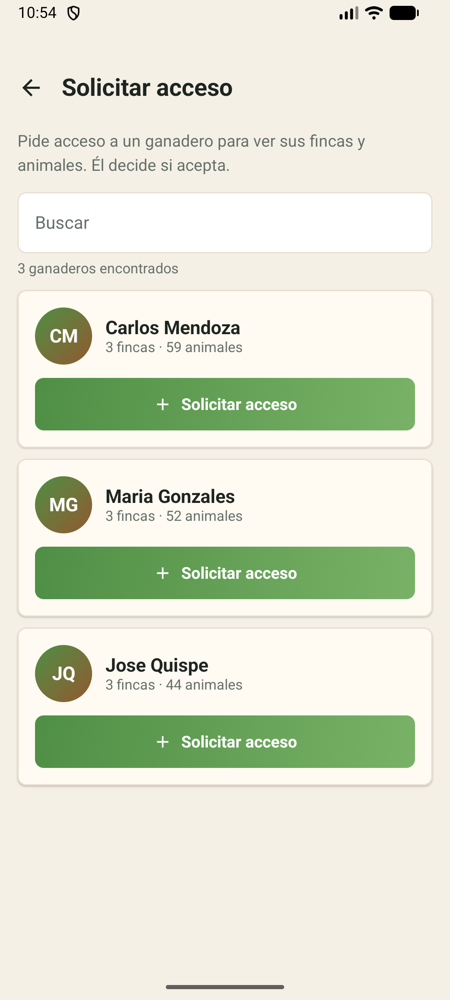 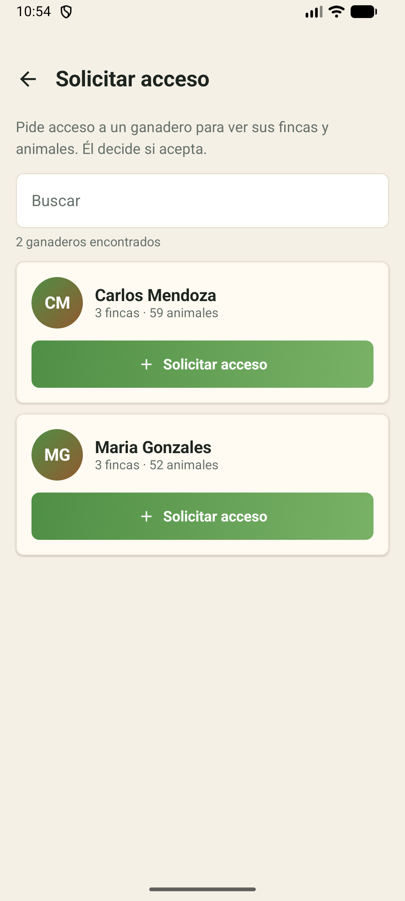
  
<i>Figuras 4.2.3.6.1 y 4.2.3.6.2. El veterinario busca un ganadero y solicita acceso (tres ganaderos disponibles); tras enviar la solicitud, ese ganadero deja de aparecer entre los disponibles (quedan dos). Fuente: elaboración propia.</i>

  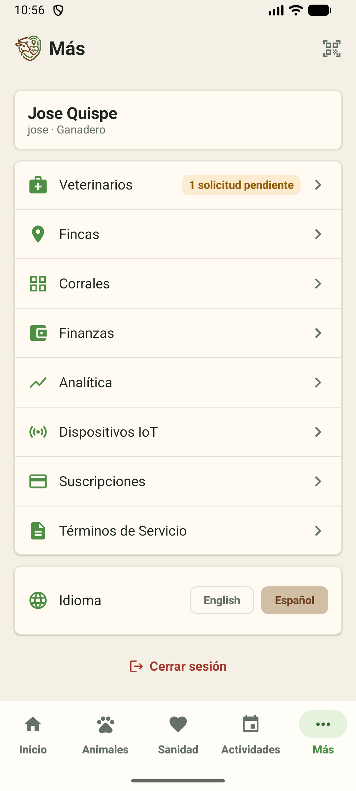 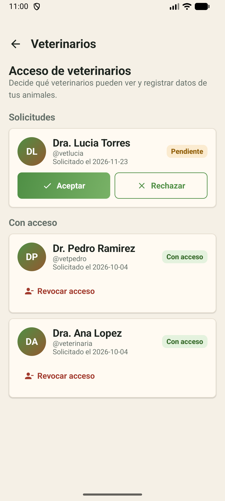
  
<i>Figuras 4.2.3.6.3 y 4.2.3.6.4. El ganadero ve la insignia de solicitudes pendientes y responde con Aceptar o Rechazar. Fuente: elaboración propia.</i>

**Conflicto de edición.** Cuando otro dispositivo cambió el registro mientras el formulario estaba abierto, el servidor responde `412`, la aplicación guarda su copia en la caché y el diálogo muestra lo que difiere con tres salidas: Conservar mis cambios, Usar la versión actual y Cancelar, que vuelve al formulario.

  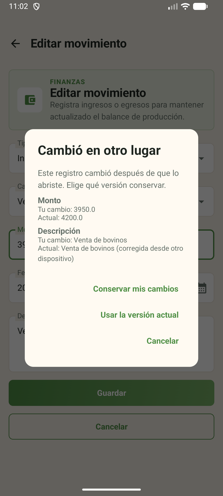
  
<i>Figura 4.2.3.6.5. Diálogo de conflicto de edición con la versión del servidor. Fuente: elaboración propia.</i>

**Recordatorios y acciones de las actividades.** Una actividad abierta ofrece Atendida y Reprogramar en su tarjeta; la aplicación pide el permiso de notificaciones desde el menú y avisa cuando están desactivadas.

  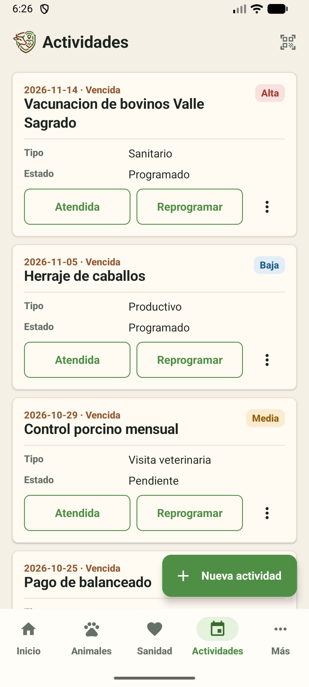 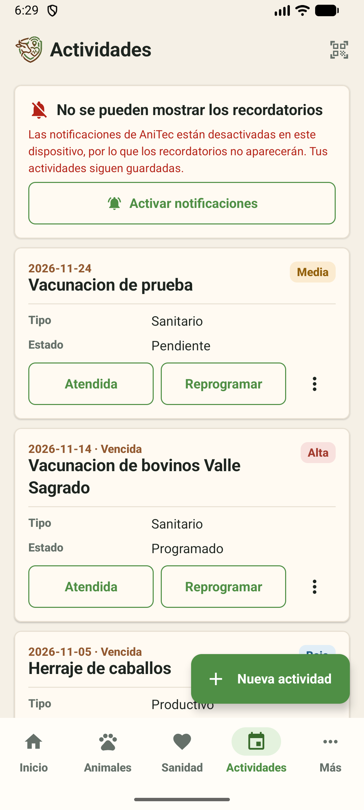
  
<i>Figuras 4.2.3.6.6 y 4.2.3.6.7. Acciones de una actividad y aviso de notificaciones desactivadas. Fuente: elaboración propia.</i>

  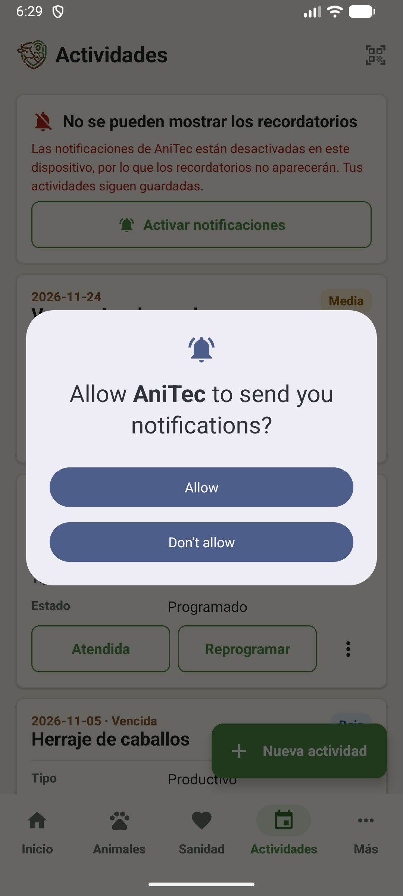 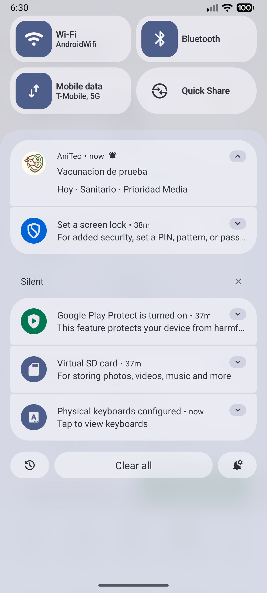
  
<i>Figuras 4.2.3.6.8 y 4.2.3.6.9. Permiso del sistema y notificación recibida. Fuente: elaboración propia.</i>

  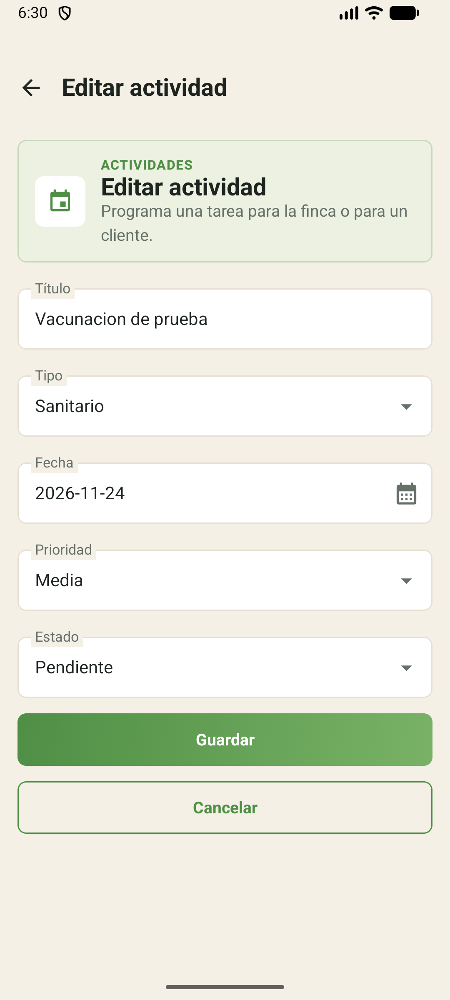 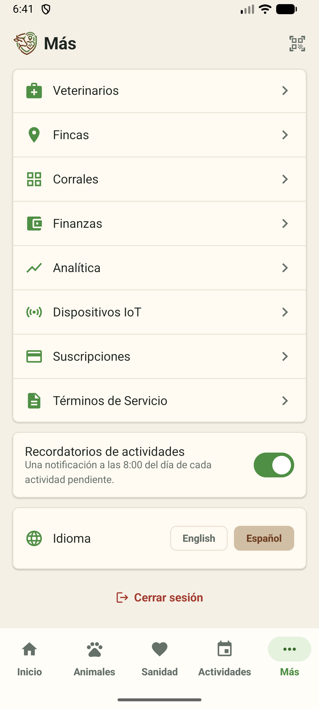
  
<i>Figuras 4.2.3.6.10 y 4.2.3.6.11. La notificación abre la actividad y el menú permite activar o desactivar los recordatorios. Fuente: elaboración propia.</i>

**Próximo control sanitario.** La fecha del próximo control debe ser un día real posterior al del registro; el formulario lo indica y no guarda en caso contrario.

  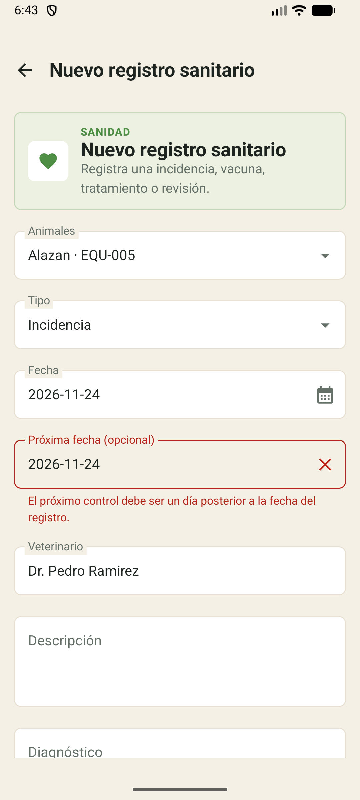
  
<i>Figura 4.2.3.6.12. Validación de la fecha del próximo control. Fuente: elaboración propia.</i>

**Defectos hallados al ejecutar los flujos.** Probar en el emulador, y no solo con pruebas automáticas, destapó defectos que se corrigieron con sus commits (sección 4.2.3.4): el botón Rechazar quedaba fuera de vista (`717ebee`), la tarjeta de un vínculo no aceptado mostraba los totales del ganadero (`717ebee` y `e8a0516`), una actividad nueva no aparecía arriba de la lista (`16a5055`), el botón flotante no tenía nombre accesible (`569c975`), los campos vacíos no viajaban en la petición (`d50ccb7`) y con texto al 200 % las etiquetas se partían a media palabra (`4e347f2`).

### 4.2.3.7. Services Documentation Evidence for Sprint Review

El Sprint 3 añade al backend el consentimiento del ganadero, las solicitudes idempotentes y las versiones con detección de conflictos. La documentación OpenAPI se genera con Swagger al ejecutar la API, y el resumen para quien consume el servicio está en `docs/sync-and-consent-contract.md` del repositorio del backend. Las capturas de Swagger de estos endpoints están pendientes porque el servicio publicado en Render aún no se redesplegó con estos cambios. La convención de llamada es la de la sección 4.2.1.7: las rutas parten de `{BASE_URL}/api/v1`, cada llamada envía `Authorization: Bearer <token>` y las solicitudes con cuerpo usan `Content-Type: application/json`.

**Consentimiento del ganadero.** Solo un vínculo `Accepted` da acceso a los datos del ganadero. Transiciones: `Pending → Accepted | Rejected` y `Accepted → Revoked`; un veterinario cuya solicitud fue rechazada o revocada puede pedir de nuevo y el mismo vínculo vuelve a `Pending`.

| Related story | HTTP | Call syntax | Parameters / body | Success response | Error responses |
|---|---|---|---|---|---|
| US-020 | POST | `curl -X POST "{BASE_URL}/api/v1/veterinarian/5/clients/1" -H "Authorization: Bearer <token>"` | Ruta: `vetId` (el del usuario autenticado) y `rancherId`. | `201` con el vínculo en `Pending`. | `404` si el usuario no es ganadero; `409` si ya hay una solicitud pendiente o un acceso activo; `401`; `403`. |
| US-020 | GET | `curl "{BASE_URL}/api/v1/veterinarian/5/clients" -H "Authorization: Bearer <token>"` | Ruta: `vetId`. | `200` con todos sus vínculos y su estado. | `401`; `403`. |
| US-020 | GET | `curl "{BASE_URL}/api/v1/veterinarian/5/available-ranchers" -H "Authorization: Bearer <token>"` | Ruta: `vetId`. | `200` con los ganaderos a los que puede pedir acceso (sin solicitud pendiente ni acceso activo). | `401`; `403`. |
| US-020 | DELETE | `curl -X DELETE "{BASE_URL}/api/v1/veterinarian/5/clients/1" -H "Authorization: Bearer <token>"` | Ruta: `vetId` y `rancherId`. | `204`: retira la solicitud o el vínculo, sea cual sea su estado. | `404`; `401`; `403`. |
| US-020 | GET | `curl "{BASE_URL}/api/v1/rancher/1/veterinarian-links?status=Pending" -H "Authorization: Bearer <token>"` | Ruta: `rancherId`. Query opcional `status`. | `200` con las solicitudes y los vínculos con la identidad del veterinario. | `401`; `403`. |
| US-021 | POST | `curl -X POST "{BASE_URL}/api/v1/rancher/1/veterinarian-links/3/accept" -H "Authorization: Bearer <token>"` | Ruta: `rancherId` y `linkId`. | `200` con el vínculo `Accepted`. | `409` si la solicitud ya fue respondida; `404`; `401`; `403`. |
| US-021 | POST | `curl -X POST "{BASE_URL}/api/v1/rancher/1/veterinarian-links/3/reject" -H "Authorization: Bearer <token>"` | Ruta: `rancherId` y `linkId`. | `200` con el vínculo `Rejected`. | `409` si la solicitud ya fue respondida; `404`; `401`; `403`. |
| US-022 | POST | `curl -X POST "{BASE_URL}/api/v1/rancher/1/veterinarian-links/3/revoke" -H "Authorization: Bearer <token>"` | Ruta: `rancherId` y `linkId`. | `200` con el vínculo `Revoked`. El veterinario sale de los rebaños del ganadero que lo nombran y deja de ver sus actividades; lo que registró antes conserva su autoría. | `404` con mensaje si no hay un acceso activo; `401`; `403`. |

**Operaciones idempotentes (`Idempotency-Key`).** En cualquier `POST` autenticado se puede enviar `Idempotency-Key: <valor único, hasta 100 caracteres>`, por ejemplo un UUID generado al encolar la operación. Sin el encabezado nada cambia.

| Related story | HTTP | Call syntax | Parameters / body | Success response | Error responses |
|---|---|---|---|---|---|
| TS-007 | POST | `curl -X POST "{BASE_URL}/api/v1/financial-records" -H "Authorization: Bearer <token>" -H "Idempotency-Key: 6f1c0a52-5c7b-4a0e-9d7e-0c2d6a1f3b11" -H "Content-Type: application/json" -d '{"type":"Ingreso","category":"Venta de leche","amount":80,"date":"2026-11-23","description":"Leche"}'` | Encabezado `Idempotency-Key`. El ejemplo usa un alta de movimiento financiero; el encabezado es igual en los demás `POST`. | La primera petición se ejecuta y, si responde `2xx`, el resultado se guarda por usuario y clave durante 24 horas. Repetir la misma petición con la misma clave devuelve el resultado guardado con `Idempotent-Replayed: true`, sin repetir el efecto. | `422` si la clave se usa con otra petición (método, ruta o cuerpo); `409` con `Retry-After` mientras la primera sigue en curso; `400` si la clave está vacía o supera los 100 caracteres. Una respuesta de error no se guarda, de modo que reintentar con la misma clave se ejecuta de nuevo. |

**Versiones y conflictos (`ETag` / `If-Match`).** Animales, eventos sanitarios, actividades y registros financieros tienen `version`, que empieza en 1 y sube en cada modificación. Las respuestas de `GET`, `POST`, `PUT` y `PATCH` la incluyen en el cuerpo y en el encabezado `ETag: "3"`.

| Related story | HTTP | Call syntax | Parameters / body | Success response | Error responses |
|---|---|---|---|---|---|
| US-032 | PUT | `curl -X PUT "{BASE_URL}/api/v1/financial-records/7" -H "Authorization: Bearer <token>" -H "If-Match: \"1\"" -H "Content-Type: application/json" -d '{"type":"Ingreso","category":"Venta de ganado","amount":3950,"date":"2026-10-15","description":"Venta de bovinos"}'` | Encabezado `If-Match` con la versión en la que se basó el cambio; el mismo encabezado se admite en `PATCH` y `DELETE`. Sin `If-Match` gana el último en escribir y `*` acepta cualquier versión. | `200` con el recurso actualizado, `version` incrementada y `ETag`. | `412` con `{"message":"...","currentVersion":2,"current":{...}}` si la versión no coincide, sin cambiar nada; `409` si dos cambios compiten en el mismo instante; `404`; `401`; `403`. |

Ante un `412`, el cliente conserva ambas copias y aplica la regla de resolución: conservar la del servidor descarta el cambio local, y conservar la propia reenvía el cambio con `If-Match: "<currentVersion>"`.

### 4.2.3.8. Software Deployment Evidence for Sprint Review

Hasta la fecha, los cambios del Sprint 3 se construyeron y se verificaron en el entorno local: el backend se ejecutó con `dotnet run` y MySQL local, y la aplicación Android se instaló en el emulador `Medium_Phone_API_37.0`. El servicio publicado en Render, la base de datos publicada y la distribución en Firebase App Distribution conservan la versión del Sprint 2, de modo que esta sección registra lo que falta desplegar y no una publicación realizada.

| Product | Platform | Configuration performed | Version / Commit | Public URL or Release | Status |
|---|---|---|---|---|---|
| Landing Page | GitHub Pages | Sin cambios en este sprint. | Sin cambios | <https://adm-1acc0238-2620-13975-grupo01.github.io/anitec-landing-page/> | Publicada (sin cambios) |
| Web Services | Render | Pendiente: integrar la rama `feature/TS-007-idempotent-sync` en `main` y redesplegar. Las migraciones `AddVeterinarianLinkClosedAt`, `AddIdempotencyRecords` y `AddRecordVersions` se aplican al iniciar el servicio. | Rama `feature/TS-007-idempotent-sync`, último commit `e8a0516` | API: <https://anitec-backend-android.onrender.com>. Swagger: <https://anitec-backend-android.onrender.com/swagger/index.html> | Pendiente de redespliegue |
| Android | Firebase App Distribution | Pendiente: compilar el APK `release` firmado con las versiones de Room 8 y 9 y distribuirlo al grupo «Equipo AniTec». La actualización sobre una versión anterior usa migraciones de Room y no la migración destructiva, para conservar las operaciones pendientes de la cola. | Rama `feature/TS-007-US-020-android-sync-and-consent`, último commit `cc7ff0b` | Sin nueva versión publicada; sigue la versión 0.2.0 del Sprint 2 | Pendiente |
| Flutter | Firebase App Distribution | Sin cambios en este sprint hasta la fecha. | Versión 1.0.0+1 | Versión 1.0.0 (1) del Sprint 2 | Publicada (sin cambios) |

**Pasos previstos para el despliegue (Web Services):**

1. Subir las ramas de trabajo, abrir sus pull requests, revisarlos e integrarlos en `main`; el push a `main` inicia el despliegue automático en Render.
2. Comprobar que el servicio aplica las tres migraciones al iniciar sobre la base publicada (las filas existentes de las cuatro tablas versionadas pasan a `version` 1) y que `SeedDemoData` sigue en `false`.
3. Verificar el servicio publicado con el flujo de consentimiento (solicitud de un veterinario y respuesta del ganadero), una repetición con la misma `Idempotency-Key` y una edición con `If-Match` desfasado.
4. Capturar en el Swagger publicado los endpoints de la sección 4.2.3.7.

**Pasos previstos para las aplicaciones móviles:** incrementar la versión de Android, generar el APK `release` con `./gradlew assembleRelease`, subirlo a App Distribution y confirmar con el grupo «Equipo AniTec» que la actualización conserva la sesión y la cola de operaciones. La aplicación Flutter se distribuirá de nuevo cuando incorpore los cambios pendientes del sprint.

### 4.2.3.9. Team Collaboration Insights during Sprint

Esta sección interpreta la participación del equipo a partir de las tareas del Sprint Backlog (sección 4.2.3.3), de los commits de los repositorios y de la colaboración por producto. Las métricas se analizan en contexto y no se usan de forma aislada para medir aporte. Los repositorios del proyecto son:

- Informe: <https://github.com/ADM-1ACC0238-2620-13975-Grupo01/Informe>
- Landing Page: <https://github.com/ADM-1ACC0238-2620-13975-Grupo01/anitec-landing-page>
- Web Services: <https://github.com/ADM-1ACC0238-2620-13975-Grupo01/anitec-backend>
- Android: <https://github.com/ADM-1ACC0238-2620-13975-Grupo01/anitec-android>
- Flutter: <https://github.com/ADM-1ACC0238-2620-13975-Grupo01/anitec-flutter>

Los commits del sprint registrados hasta la fecha son 7 en el backend y 15 en Android, todos en ramas de trabajo con el formato Conventional Commits y con las historias o tareas técnicas relacionadas en el mensaje. No hay commits del sprint en Flutter.

| Integrante | Productos / aspectos | Contribución en el sprint | Evidencia | Reflexión |
|---|---|---|---|---|
| Sebastian Martin Beingolea Montalvo | Pendiente de completar por el equipo | Pendiente de completar por el equipo | Pendiente de completar por el equipo | Pendiente de completar por el equipo |
| Josep Eliu Melgarejo Quiroz | Pendiente de completar por el equipo | Pendiente de completar por el equipo | Pendiente de completar por el equipo | Pendiente de completar por el equipo |
| Saul Ortega Muñoz | Pendiente de completar por el equipo | Pendiente de completar por el equipo | Pendiente de completar por el equipo | Pendiente de completar por el equipo |
| Luciana Celeste Sanchez Silva | Pendiente de completar por el equipo | Pendiente de completar por el equipo | Pendiente de completar por el equipo | Pendiente de completar por el equipo |
| Giuseppe Villanueva Rodriguez | Pendiente de completar por el equipo | Pendiente de completar por el equipo | Pendiente de completar por el equipo | Pendiente de completar por el equipo |

Las capturas de los analíticos de colaboración y de commits de GitHub (**Insights → Contributors** y **Insights → Commits**) de cada repositorio se incorporarán cuando las ramas del sprint se integren en `main`, porque esos analíticos solo cuentan los commits de la rama principal.

**Conclusión del trabajo en equipo.** A la fecha de redacción, el sprint entregó el consentimiento del ganadero sobre el acceso veterinario, la sincronización con claves de idempotencia y detección de conflictos, los recordatorios locales de las actividades, el contraste y los nombres accesibles de las pantallas principales de Android y las pruebas automáticas de los flujos críticos. El backend pasó de 150 a 226 pruebas y Android de 214 a 309 pruebas unitarias y de 16 a 42 instrumentadas. De las 17 historias, 8 están completas, 4 parciales y 5 pendientes, y las tareas de persistencia local en Flutter, corrección de registros sanitarios con trazabilidad, mediciones de seguridad, rendimiento y recuperación, redespliegue y distribución siguen abiertas. Como aprendizajes, el equipo destaca que reproducir los flujos en el emulador descubrió defectos que las pruebas unitarias no cubrían (botones fuera de vista, totales visibles sin consentimiento y campos vacíos que no viajaban), que una prueba de integración con un servidor falso que sigue las reglas del API detecta errores de lectura del cuerpo de las respuestas, y que fijar el contraste con una prueba evita que la accesibilidad se degrade al cambiar el tema. Como límites conocidos, los recordatorios se programan a las 08:00 y WorkManager no garantiza la hora exacta, la actividad creada desde el próximo control no queda enlazada al registro sanitario, `If-Match` no se envía todavía en las eliminaciones ni en el cambio de estado de un animal, la etiqueta «Actividades» de la barra inferior se recorta con texto mayor al 100 %, y no se recorrió TalkBack con gestos en cada pantalla.
