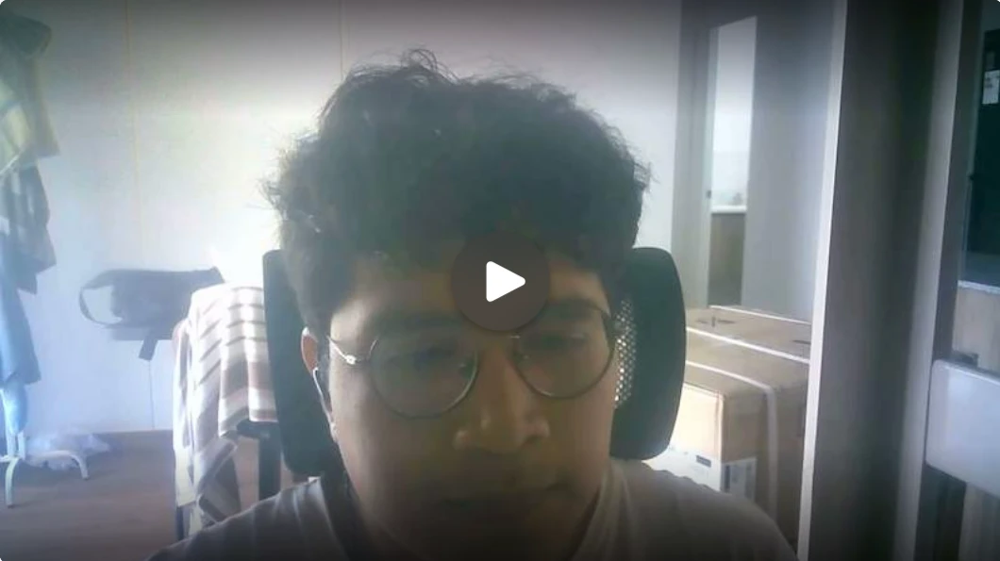

# Conclusiones

El proyecto AniTec permitió validar la necesidad de una solución digital orientada a ganaderos y veterinarios, debido a que ambos segmentos requieren mayor orden, trazabilidad y disponibilidad de información sobre animales, fincas, actividades, sanidad y gastos. Las entrevistas y validaciones realizadas confirmaron que el problema identificado es real y que una aplicación móvil puede aportar valor si mantiene una experiencia simple, clara y cercana al contexto ganadero.

El diseño basado en Domain-Driven Design permitió organizar AniTec en nueve bounded contexts: Identity and Access Management, Profile Management, Livestock Management, Sanitary Management, Veterinary Collaboration, Activity Management, Financial Management, Subscription Management y Analytics and Reporting. Esta separación favorece la mantenibilidad, delimita responsabilidades y permite que cada módulo evolucione sin afectar innecesariamente a los demás.

Durante el Sprint 1 se desplegó la landing page, se adaptó el backend para el consumo móvil y se construyó la base de la aplicación Android con los flujos de acceso, fincas, corrales, animales y registros sanitarios. Este avance permitió contar con una primera versión ejecutable y trazable con el Product Backlog.

Durante el Sprint 2 se completó el backend, se ampliaron los flujos de Android para ganaderos y veterinarios y se entregó una primera versión de Flutter. También se incorporaron el trabajo sin conexión, la identificación mediante QR, las suscripciones con Stripe, la analítica y la distribución de versiones móviles.

El Sprint 3 concentra el cierre del consentimiento veterinario, las notificaciones, la sincronización idempotente, la persistencia local en Flutter, la accesibilidad, la protección de datos, el rendimiento, la recuperación ante fallos y las pruebas automatizadas de los flujos críticos.

La documentación de servicios mediante Swagger/OpenAPI permitió verificar los endpoints implementados y facilitar las pruebas manuales del backend. Asimismo, las migraciones de Entity Framework Core permitieron mantener alineada la estructura de la base de datos con las entidades del dominio, reduciendo errores en la configuración y mejorando la trazabilidad técnica del sistema.

El despliegue del backend en Render representa un avance importante, ya que permite que las aplicaciones móviles consuman la API desde un entorno publicado. Esto facilita las pruebas de integración entre Android, Flutter, el backend y la base de datos en condiciones más cercanas al uso real.

En relación con el Student Outcome, el equipo evidenció trabajo colaborativo y liderazgo conjunto durante los tres avances. Cada integrante asumió responsabilidades claras por módulo o artefacto, participó en la planificación de tareas, colaboró en la integración del sistema y aportó a la documentación del producto. Esto permitió cumplir los objetivos de cada sprint de forma progresiva y mantener coherencia entre la propuesta, el diseño, el frontend, el backend y el despliegue.

**Contraste con Lean UX y validaciones:**

El Problem Statement se mantiene vigente, ya que las validaciones confirmaron que ganaderos y veterinarios siguen enfrentando problemas de desorden, registros manuales y falta de trazabilidad. AniTec responde a una necesidad real al centralizar información sanitaria, productiva, económica y operativa en una sola plataforma.

Las Business Assumptions fueron validadas de forma general, debido a que los usuarios reconocieron valor en contar con una solución móvil para registrar animales, eventos sanitarios, actividades, finanzas y clientes veterinarios. Sin embargo, todavía se requiere reforzar los reportes, las alertas y algunos campos específicos para aumentar la utilidad percibida.

Las User Assumptions se confirmaron parcialmente, porque los entrevistados comprendieron la navegación por roles y consideraron útiles los dashboards y módulos principales. Aun así, la experiencia debe seguir simplificándose, especialmente en formularios y mensajes de error.

Las Feature Assumptions resultaron pertinentes para una primera versión del producto, ya que los usuarios identificaron valor en el registro de animales, historial sanitario, actividades, finanzas y seguimiento veterinario. Como mejora futura, se deben ampliar los campos clínicos, datos del animal y métricas disponibles para apoyar mejores decisiones.

Las Hypothesis Statements fueron parcialmente validadas. Existe interés inicial y una percepción positiva sobre la utilidad de AniTec, especialmente por la centralización de información; no obstante, la adopción dependerá de fortalecer la confianza, mejorar recordatorios, optimizar reportes y facilitar el uso continuo de la plataforma.

Los criterios de éxito quedan planteados como metas para una siguiente etapa de validación con uso real de la aplicación desplegada. Las entrevistas permiten confirmar intención de uso y valor percibido, pero aún falta medir reducción de errores, mejora en precisión de registros y apoyo efectivo a decisiones basadas en datos.

## Recomendaciones

**Corto plazo:** Se recomienda completar las historias previstas para el Sprint 3 y verificar los flujos principales de Android y Flutter contra el backend publicado, con especial atención a la autorización, la sincronización y la recuperación ante fallos.

**Corto plazo:** Se recomienda fortalecer la autenticación y autorización del sistema, definiendo permisos por rol para ganaderos, veterinarios y administradores. Esto permitiría proteger los endpoints sensibles y asegurar que cada usuario solo acceda a la información correspondiente a su perfil.

**Mediano plazo:** Se recomienda continuar la validación con ganaderos y veterinarios usando la aplicación desplegada, no solo prototipos. Esto permitirá identificar problemas reales de uso, comprensión del lenguaje, dificultad en formularios, utilidad de dashboards y necesidades adicionales en los módulos de sanidad, actividades y finanzas.

**Mediano plazo:** Se recomienda mejorar la experiencia de las aplicaciones móviles en una siguiente iteración, priorizando la claridad de los paneles, la simplificación de los formularios y la organización del flujo veterinario por clientes autorizados.

**Mediano plazo:** Se recomienda completar y fortalecer las pruebas del backend, incluyendo pruebas de endpoints, validación de reglas de negocio, manejo de errores y pruebas de integración con la base de datos. Esto ayudará a asegurar mayor estabilidad antes de seguir ampliando funcionalidades.

**Hoja de ruta futura:** Se recomienda mantener actualizada la documentación técnica, incluidos los endpoints, las migraciones, las evidencias de despliegue, los diagramas C4 y las decisiones de arquitectura. A medida que AniTec crezca, esta documentación será clave para sostener la colaboración del equipo y facilitar futuras mejoras del producto.

---

## Video About the Team

El video About the Team presenta la participación de los integrantes del equipo Titan Team 4 durante el desarrollo de AniTec y destaca las actividades realizadas, los logros alcanzados y las competencias asociadas con el trabajo colaborativo, el liderazgo conjunto, la planificación de tareas y el cumplimiento de objetivos.

**Datos del video:**

| Elemento | Información |
| -------- | ----------- |
| Título | Video About the Team — AniTec |
| Duración | 5 min 22 s |
| Público objetivo | Docente del curso, visitantes de la landing page y personas interesadas en conocer el proceso de trabajo del equipo |
| URL publicada en Microsoft Stream | [Ver video About the Team](https://upcedupe-my.sharepoint.com/:v:/g/personal/u202315165_upc_edu_pe/IQBs8pOR_ON9R7t3I62NIdowAefCYvQ1QxYzdkCpkamyplY?nav=eyJyZWZlcnJhbEluZm8iOnsicmVmZXJyYWxBcHAiOiJTdHJlYW1XZWJBcHAiLCJyZWZlcnJhbFZpZXciOiJTaGFyZURpYWxvZy1MaW5rIiwicmVmZXJyYWxBcHBQbGF0Zm9ybSI6IldlYiIsInJlZmVycmFsTW9kZSI6InZpZXcifX0%3D&e=22j0OG) |
| URL publicada en YouTube | [Ver video en YouTube](https://youtu.be/H8bZXUCpMkE) |
| Uso en la landing page | El video de YouTube se utiliza como evidencia pública del proceso de trabajo del equipo. |

**URL del video publicado en Microsoft Stream:**

<https://upcedupe-my.sharepoint.com/:v:/g/personal/u202315165_upc_edu_pe/IQBs8pOR_ON9R7t3I62NIdowAefCYvQ1QxYzdkCpkamyplY?nav=eyJyZWZlcnJhbEluZm8iOnsicmVmZXJyYWxBcHAiOiJTdHJlYW1XZWJBcHAiLCJyZWZlcnJhbFZpZXciOiJTaGFyZURpYWxvZy1MaW5rIiwicmVmZXJyYWxBcHBQbGF0Zm9ybSI6IldlYiIsInJlZmVycmFsTW9kZSI6InZpZXcifX0%3D&e=22j0OG>

**URL del video publicado en YouTube:**

<https://youtu.be/H8bZXUCpMkE>

    
    
<i>Fotograma del video About the Team. <b>Fuente</b>: elaboración propia.</i>

